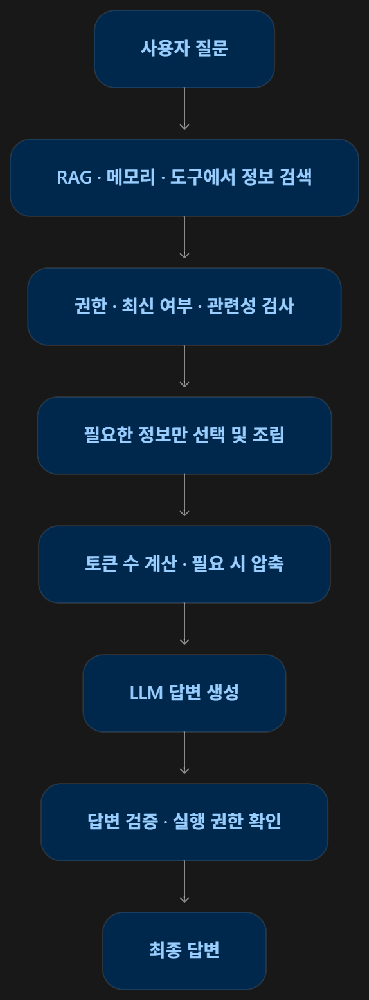

# Context Engineering 

Context Engineering은 LLM이 정확한 답변을 만들도록 **필요한 정보를 선택하고, 정리하고, 기억하고, 안전하게 전달하는 기술**이다.

# 1. 전체 구조도





| 구분  | 핵심 개념            | 쉽게 설명하면                    |
| --- | ---------------- | -------------------------- |
| 1장  | Context 구성       | LLM에 어떤 정보를 넣을지 결정         |
| 1장  | 우선순위·Skills      | 권한과 유효성을 확인하고 필요한 자료·절차 선택 |
| 2장  | Memory           | 이전 대화에서 필요한 정보 기억          |
| 2장  | Mem0             | 기억을 저장·검색·수정·삭제하는 도구       |
| 3장  | Token Budget     | LLM에 넣을 수 있는 입력 길이 관리      |
| 3장  | Sliding Window   | 최근 대화만 일정 범위로 유지           |
| 3장  | Summary          | 중요한 사실과 조건을 남기며 유혹         |
| 4장  | Prompt Caching   | 반복되는 입력의 계산을 재사용           |
| 4장  | Prompt Injection | 자료에 섞인 악의적인 지시를 구분하고 방어    |

# 꼭 알아야 할 기술 간차이

| 기술                  | 핵심 역할                      |
| ------------------- | -------------------------- |
| Prompt Engineering  | LLM에게 어떻게 답할지 지시           |
| RAG                 | 답변에 필요한 외부 문서를 검색          |
| Context Engineering | 검색 문서, 메모리, 대화 등을 전체적으로 관리 |

세 기술은 서로 대체하는 관계가 아니라 함께 사용하는 기술이다. 

1) 필요한 문서만 선택

```python

docs = [
	d for d in documents
	if d["status"] == "current"
]
```

`for` 로 문서를 하나씩 확인하고, `if` 조건에 맞는 현행 문서만 선택한다.

2) 메모리의 현재 값 갱신

```python
if field in current:
	previous.append(current[field])
	
current[field] = event.copy()
```

같은 항목이 이미 있으면 이전 값을 보관하고 새로운 값으로 갱신한다. 


3) 입력 토큰 예산 계산

```python
input_budget = request_limit - output_reserve = margin
```

전체 한도에서 출력 예약과 여유분을 제외한다.

4) 의심 문구 검사

```python
if any(pharse in text for phrase in suspicious):
	quarantined.append(doc_id)
```

문서에 의심 문구가 하나라도 포함되어 있으면 격리합니다. 단, 이 방식만으로 모든 공격을 탐지할 수 없습니다.


# 실무에서 어떻게 사용할까? 

질문: "13만 원짜리 숙소도 정산할 수있나요?"

1. **RAG**: 현행 출장 규정 검색
2. **Memory**: 필요한 이전 대화 정보 확인
3. **Context 선택**: 숙박 한도 12만 원, 초과 승인 조건, 영수증 조건 선택
4. **Token Budget**: 입력 길이가 한도를 초과하는지 검사
5. **LLM**: 근거를 바탕으로 답변 생성
6. **검증**: 사전 승인 여부를 단정하지 않았는지 확인

이 과정 전체를 설계하는 것이 Context Engineering이다.

# 최종 핵심 TOP 5

- **Context**: LLM이 답변할 때 참고하는 정보
- **Memory**: 다음 대화에서도 사용할 정보를 관리
- **Token Budget**: 입력과 출력의 토큰 공간 관리
- **Prompt Caching**: 반복 계산을 줄여 효율 개선
- **Prompt Injection**: 외부 자료의 악의적인 지시로부터 시스템 보호 

### 한 줄 요약: 

RAG가 필요한 정보를 찾는 기술이라면, Context Engineering은 찾은 정보와 기억을 **올바르게 선택하고, 길이를 관리하고, 안전하게 LLM에 전달하는 기술**이다. 
