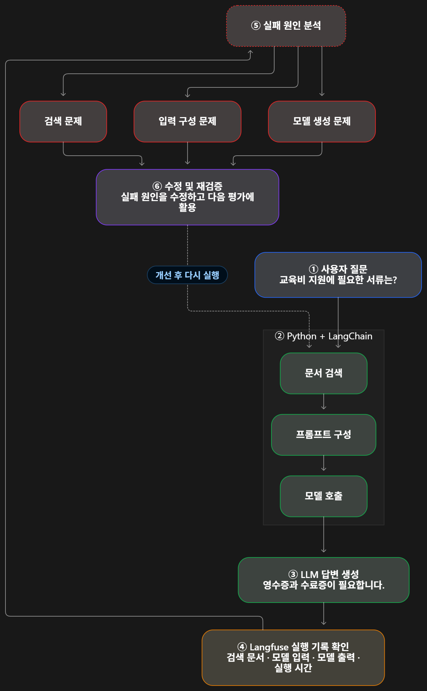

# 1. 전체 흐름 이해 

**오늘의 핵심**: AI가 답변을 생성한 뒤, 그 과정에서 무엇이 일어났는지 기록하고 문제가 발생한 위치를 찾아 개선하는 방법을 배운다.

#LLMOps #Langfuse #Trace #Observability #오류분석

### LangChain + Langfuse 실행 및 개선 흐름도 




# 2. 강의 목차 

| 구분  | 학습 주제            | 핵심 내용                        |
| --- | ---------------- | ---------------------------- |
| 1-1 | LLMOps와 요청 단위 관측 | Trace, Observation, Span     |
| 1-2 | Trace 재조회        | flush(),Trace ID, Generation |
| 1-3 | 검색과 업무 도구 추적     | 검색 결과, 업무 조회, 실행 시간          |
| 1-4 | 실패 원인 분류         | 오류 유형과 실패 판정                 |

# 3. 핵심 개념 정리 

### ① LLMOps란?

**LLMOps(Large Language Model Operations)**는 LLM 기반 서비스를 관측하고 평가하며, 발생한 문제를 찾아 지속적으로 개선하는 운영 과정이다.

강의 1장에서는 특히 AI가 답변을 만드는 과정에서 발생한 기록을 확인하고 오류 원인을 분석하는 방법에 집중한다.

### ② Trace와 Observation

- Trace: 사용자 요청 하나의 전체 실행 기록
    
- Observation: Trace 내부에 포함된 개별 작업 기록
    
- Span: 특정 작업의 시작부터 종료까지 기록하는 구간
    
- Generation: LLM 호출에 특화된 작업 기록
    

Trace: 교육비 질문 하나

retrieve · Span

교육비 규정 검색

ChatPromptTemplate · Chain

문서와 질문으로 메시지 구성

ChatOpenAI · Generation

실제 모델 호출 및 답변 생성

쉽게 말하면 Trace는 전체 작업 기록, Span은 그 안의 작업 구간, Generation은 모델 호출 기록이다.

### ③ Observability(관측 가능성)

시스템에서 어떤 일이 일어났는지 실행 기록을 통해 파악하는 것이다.

예를 들어 교육비 답변에서 수료증이 누락되었다고 가정하자.

|확인 단계|발견된 문제|수정 대상|
|---|---|---|
|검색|관련 문서를 찾지 못함|검색 로직|
|입력 조립|문서는 찾았지만 수료증 내용이 빠짐|Context 구성|
|답변 생성|근거는 전달됐지만 답변에서 누락|프롬프트·출력 검사|

중요한 점: 답변이 틀렸다고 무조건 LLM이나 프롬프트부터 수정하지 않는다. 문제가 처음 발생한 위치부터 확인한다.

### ④ Trace 재조회와 `flush()`

이번 강의에서는 다음 세 단계를 구분한다.

1. Python 터미널에 모델 답변이 출력됨
    
2. `flush()`로 남아 있는 추적 기록의 전송을 처리함
    
3. Langfuse 서버에서 Trace ID로 기록을 다시 조회함
    

특히 `flush()`가 끝났다는 사실과 서버에서 기록을 조회할 수 있다는 사실은 다르다.

또한 `GENERATION`에 종료 시각이 있다고 해서 답변이 정확하다는 뜻은 아니다.

### ⑤ Failure Classification(실패 분류)

실행 기록을 분석해 문제가 발생한 이유를 분류한다.

|상태|의미|
|---|---|
|`completed`|실행 기록의 정상 조건 충족|
|`incomplete`|실행 상태를 확인할 정보 부족|
|`invalid_time`|시작·종료 시간 정보 오류|
|`model_error`|모델 실행 실패|
|`retrieval_empty`|검색된 문서가 없음|

예를 들어 검색 결과가 비어 있더라도 규정에 존재하지 않는 질문이라면 답변을 보류하는 것이 올바른 행동일 수 있다.

따라서 검색 결과 없음 = 무조건 잘못된 답변은 아니다.

## 4. 오늘의 핵심 Python 코드

강의 원본 기반 · 한국어 주석 추가

```python
def locate(question, context, answer):

    # 1. 검색된 문서가 없으면 검색 문제
    if not retrieve(question):
        return "검색"

    # 2. 모델 입력에 필요한 정보가 없으면 입력 조립 문제
    if not all(term in context for term in REQUIRED):
        return "입력 조립"

    # 3. 모델 답변에서 필수 정보가 누락되면 생성 문제
    if not all(term in answer for term in REQUIRED):
        return "생성"

    # 4. 모든 조건을 통과하면 정상
    return "정상"
```

이 코드에서 가장 중요한 부분은 `if`와 `return`이다.

`if`는 조건을 확인하고, `return`은 결과를 반환하면서 함수를 종료한다. 따라서 앞 단계에서 문제가 발견되면 뒤 단계는 검사하지 않는다.

## 5. 강의 파일별 역할

|파일|역할|모델 호출|
|---|---|---|
|`00_start.py`|Langfuse 연결과 첫 응답 확인|1회|
|`01_trace.py`|사용자 질문의 Trace 기록|1회|
|`02_read_trace.py`|기록된 Trace 재조회|없음|
|`03_steps.py`|검색과 업무 도구 실행 과정 추적|1회|
|`04_failures.py`|모의 실패 사례 분류|없음|

## 6. 1장과 2장은 어떻게 연결될까?

1장: 실행 관측

문제가 어디에서 발생했는지 찾는다.

Trace · Observation · 오류 분류

2장: 성능 평가

문제를 수정한 뒤 실제로 개선됐는지 확인한다.

Golden Dataset · Evaluator · 비교

# 📌 최종 한 줄 정리

**LLMOps 1장은 AI의 실행 과정을 기록하고 오류가 발생한 위치를 찾는 방법을 배우는 과정이다.** 
**2장은 그 오류를 수정한 뒤 동일한 평가 기준으로 성능이 개선되었는지 검증하는 과정이다**. 
