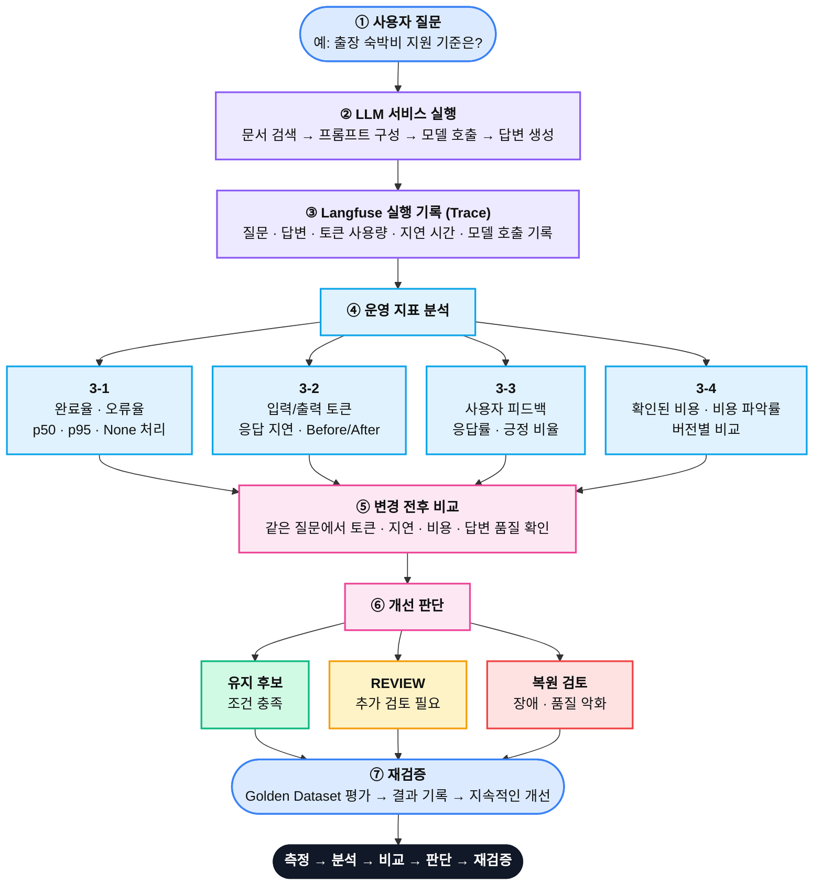

### 학습 내용: LLMOps 3장 (운영 지표·사용자 피드백·개선 판단)

# 0. 3장 전체 구조도




# 1. 오늘 공부한 내용

오늘은 LLMOps 3장을 공부하면서 LLM 서비스를 운영할 때 어떤 지표를 확인해야 하고, 그 지표를 바탕으로 어떻게 개선 여부를 판단하는지 배웠다.

이전에는 모델이 정확한 답변을 생성하는 것이 중요하다고 생각했는데, 실제 운영에서는 **응답속도, 오류율, 토큰 사용량, 비용, 사용자 만족도**까지 함께 확인해야 한다는 것을 알게 되었다.

특히 숫자가 좋아졌다고 무조건 서비스가 개선되는 것은 아니라는 점이 인상 깊었다.

# 2. 핵심 개념 정리

| 개념            | 배운내용                  |
| ------------- | --------------------- |
| SLI           | 실제로 측정하는 서비스 성능 지표    |
| SLO           | 서비스가 달성해야 하는 성능 목표    |
| p50           | 응답 시간의 중앙값            |
| p95           | 느린 요청까지 확인하는 95백분위 지연 |
| Latency       | 요청 처리에 걸린 시간          |
| Token Usage   | 모델이 사용한 입력·출력 토큰      |
| Trace         | 요청 하나의 실행 기록          |
| Cost Coverage | 전체 요청 중 비율을 확인하는 비율   |

가장 중요하게 배운 것은 **지표마다 계산에 사용하는 데이터와 분모가 다르다는 점이다.

예를 들어 완료된 요청 3건의 응답 시간이 100ms, 200ms, 900ms 라면 p50은 200ms, 900ms가 된다.

하지만 900ms 요청이 타임아웃되어 완료 목록에서 빠지면 p95가 낮아질 수 있다. 따라서 응답 시간만 볼 것이 아니라 완료율과 오류율도 함께 확인 해야한다. 

또한 None은 0이 아니라 아직 확인되지 않은 값이므로 함부로 0으로 바꾸면 안 된다는 것도 배웠다.

# 3. Python 코드 실습

```python
# 완료된 요청만 추출
finished = [
	r for r in rows
	if r["status"] == "completed"
]

# 명시적으로 실패한 요청 수 계산 
errors = sum(
	r["status"] == "failed"
	for r in rows
)
# 비용이 홗인된 요청만 추출 
costs = [
	r["cost_usd"]
	for r in rows
	if r["cost_usd"] is not None
]
```

리스트 컴프리헨션으로 필요한 요청만 선택하고, `sum()` 을 이용해 실패한 요청 수를 계산하는 방법을 복습했다. 특히 `is not None`을 사용해 누락된 비용을 제외하고 확인된 비용만 합산하는 부분이 중요했다.

# 4. Langfuse와 운영 개선

Langfuse에서는 Trace를 통해 모델 실행 과정과 토큰 사용량, 응답 시간 등을 확인할 수 있다.

도한 trace_id를 이용해 특정 답변에 사용자 피드백을 연결할 수 있다는 점을 배웠다.

오늘 강의에서는 같은 질문에 불필요한 문맥을 제거하는 Before/After 비교도 진행했다.

- Before 입력 토큰: 858개
- After 입력 토큰: 138개
- 입력 토큰 감소: 720개

불필요한 문맥을 제거하면 토큰을 절약할 수 있지만, 응답 시간이 같은 비율로 줄어드는 것은 아니었다.

또한 비용과 지연이 감소했더라도 표본이 충분하지 않거나 답변 품질이 검증되지 않았다면 바로 적용하지 않고 REVIEW로 판단해야 한다는 것을 배웠다.

# 5. 헷갈렸던 부분 

처음에는 p95가 낮아지면 무조건 서비스가 빨라졌다고 생각했다.

하지만 느린 요청이 실패하면서 집계에서 제외된 경우에도 p95가 개선된 것처럼 보일 수 있다는 사실을 알게 되었다.

또한 API 요청이 성공했다고 해서 사용자가 답변에 만족한 것은 아니라는 점도 새롭게 이해했다.

**기술적 성공과 답변 품질은 서로 다른 기준으로 평가해야 한다.**


# 6. 오늘의 느낀점 

오늘 학습을 통해 LLMOps는 단순히 모델 실행 기록을 확인하는 기술이 아니라, 데이터를 근거로 문제를 분석하고 개선 방향을 결정하는 과정이라는 것을 이해했다.

특히 비용이나 응답 속도 같은 숫자만 보고 성능이 좋아졌다고 판단하지 않고, 답변의 정확성과 사용자 경험까지 함께 고려해야 한다는 점을 기억하고 싶다.

앞으로 LLM 프로젝트를 진행할 때도 Langfuse를 활용해 실행 기록을 분석하고, 변경 전후의 성능을 객관적으로 비교하는 연습을 해야겠다. 

#  ✅ 오늘의 한 줄 정리

**LLMOps는 LLM의 품질·속도·비용·오류를 함께 측정하고, 숫자의 의미를 정확하게 해석해 서비스를 지속적으로 개선하는 과정이다.** 
