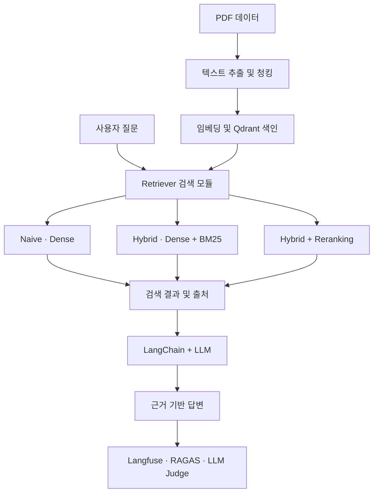

# 개인 개발 일지 | KANT PROJECT 3 - DAY 1

**날짜**: 2026년 11월 5일 (목)
**프로젝트**: PDF 기반 RAG Q&A 서비스 구축
**담당 역할**: Retriever(검색 모듈)
**진행 단계**: 프로젝트 시작 · 역할 및 구현 구조 이해

# 1. 오늘의 활동 요약

오늘부터 KANT PROJECT 3을 시작했다.

이번 프로젝트는 PDF 문서를 검색 가능한 데이터로 변환하고, 이를 활용해 사용자의 질문에 근거 기반 답변을 제공하는 RAG Q&A 서비스를 구현하는 프로젝트이다.

특히 Naive RAG, Hybrid RAG, Hybrid + Reranking의 세 가지 검색 방식을 같은 조건에서 비교하고, 검색 정확도와 답변 품질을 평가해 최종 구성을 선정하는 것이 핵심 목표이다. 

우리 팀은 총 4명으로 구성되었으며, 각자 기능을 모듈화해 개발하기로 했다. 그 중 나는 **Retriever(문서 검색기)**를 담당하게 되었다.

오늘은 실제 코드를 구현하기보다 프로젝트의 전체 흐름을 이해하고, Retriever의 역할과 개발 순서를 정리하는 데 집중했다.

# 2. 프로젝트 전체 구조와 내 역할 

프로젝트는 다음과 같은 흐름으로 진행된다. 

Retriever는 사용자의 질문과 관련성이 높은 문서 청크를 찾아 LLM에 전달하는 역할을 한다.

처음에는 단순히 문서를 찾는 기능이라고 생각했지만, 전체 구조를 살펴보면서 검색 결과의 품질이 LLM의 답변 품질에 큰 영향을 준다는 점을 이해하게 되었다. 

관련 문서를 찾지 못하거나 잘못된 내용을 검색하면 LLM도 정확한 답변을 만들기 어려워진다. 따라서 Retriever는 RAG 시스템의 중요한 구성 요소이다. 

## 팀 내 역할 구분

| 담당 모듈               | 주요 작업                                                  |
| ------------------- | ------------------------------------------------------ |
| Data Procssing      | PDF 텍스트 추출, 청킹, 임베딩, Qdrant 인덱스 구축, 입출력 형식 정의          |
| Retriever           | Dense 검색, BM25, Hybrid RAG, Reranking 구현               |
| RAG Service / API   | FastAPI, LangChain, LLM 답변 생성, 출처 검증                   |
| Evaluation / LLMOps | Hit@k, Recall@k, RAGAS, LLM Judge, Langfuse 추적 및 결과 비교 |

데이터 전처리 담당 팀원이 검색에 필요한 데이터와 인덱스를 준비하면, 나는 이를 활용해 Retriever를 구현하는 구조이다.

# 3. Retriever에서 구현할 세 가지 검색 방식

### ① Naive RAG - Dense 검색

Dense 검색은 사용자의 질문과 문서의 **의미적 유사도**를 계산해 관련 문서를 찾는 방식이다.

질문과 문서의 단어가 정확히 일치하지 않아도 의미가 비슷하면 검색할 수 있다.

**구현 방향**
- E5를 활용한 질문 임베딩 생성
- Qdrant 벡터 인덱스 연결
- 질문과 유사한 상위 k개 청크 검색
- 검색 결과에 문서 ID와 페이지 정보 보존 

### ② Hybrid RAG - Dense + BM25

Hybird 검색은 의미 검색과 키워드 검색을 결합하는 방식이다.

Dense 검색은 문장의 의미를 중심으로 검색하고, BM25는 질문에 포함된 주요 단어와 문서의 일치도를 계산한다.

두 검색 결과를 결합하면 의미적 유사성과 정확한 키워드를 함께 고려할 수 있다.

**구현 방향**
- BM25 검색기 구현
- Dense 및 BM25 검색 결과 수집
- 중복 청크 제거
- RRF 등의 방식으로 검색 순위 결합
- 통합 검색 결과 반환

**RRF(Reciprocal Rank Fusion)**는 서로 다른 검색기의 원래 점수를 직접 비교하지 않고, 각각의 검색 순위를 활용해 결과를 결합하는 방법이다.

### ③ Hybrid + Reranking - 검색 결과 재정렬

Reranking은 Hybird 검색으로 찾은 후보 문서를 질문과 다시 비교하여 관련성이 높은 순서로 재정렬하는 방식이다.

CrossEncoder를 활용할 계획이다.

**구현 방향**
- Hybird 검색으로 후보 청크 확보
- CrossEncoder를 이용해 질문과 후보 문서의 관련성 계산
- 관련성 점수에 따라 후보 재정렬
- 최종 상위 k개 청크 반환

Hybrid + Reranking에서는 최종 반환할 k개보다 많은 후보를 먼저 검색한 뒤 재정렬하는 방식이 일반적이다. 

# 4. 개발 전 준비 - 데이터와 인터페이스 확인

오늘 가장 중요하게 생각한 부분은 **팀원 간 데이터 형식과 함수 사용법을 먼저 통일하는 것**이다.

Retriever가 정상적으로 동작하더라도 다른 팀원이 생성한 데이터와 연결되지 않으면 전체 서비스는 제대로 작동하지 않는다.

따라서 실제 구현에 앞서 데이터 전처리 담당 팀원과 검색 결과 구조 및 Qdrant 설정을 확인해야 한다.

### 전달받아야 할 정보

- Qdrant 연결 주소 및 컬렉션 이름
    
- 임베딩 모델 이름과 버전
    
- 정규화 및 `query:` / `passage:` 접두어 설정
    
- 벡터 차원과 거리 함수(Cosine 등)
    
- 청크 본문과 메타데이터 필드 구조
    
- BM25용 전체 청크 데이터 또는 키워드 인덱스
    
- 검색 모듈의 입출력 스키마 및 호출 규칙
    
- Qdrant 컬렉션에 접근하는 방법

### 청크 데이터에서 확인할 필드

| 필드        | 역할             |
| --------- | -------------- |
| chunk_id  | 청크의 고유 식별자     |
| book_id   | 원본 PDF 문서 ID   |
| file_name | 출처 파일명         |
| page      | PDF 페이지 번호     |
| content   | 실제 검색에 사용할 텍스트 |

임시 청크 데이터를 받으면 먼저 **전체 청크 수, 빈 텍스트, 중복 chunk_id, 필수 메타데이터 누락 여부**를 확인할 계획이다.

**완료 기준**: 임시 청크를 Python으로 읽고, 각 청크의 내용과 출처를 확인할 수 있어야 한다.

# 5. Retriever 개발 진행 순서 