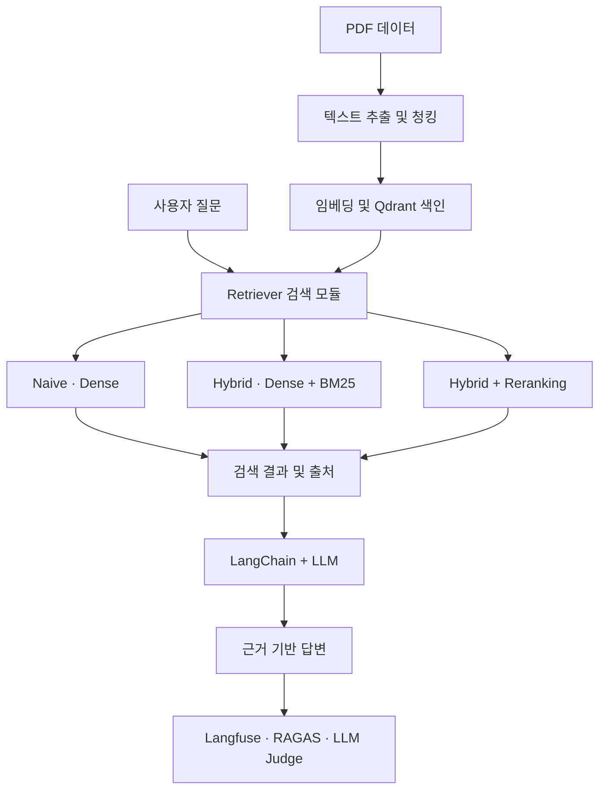

# 개인 개발 일지 | KANT PROJECT 3 - DAY 1

**날짜**: 2026년 11월 5일 (목)
**프로젝트**: PDF 기반 RAG Q&A 서비스 구축
**담당 역할**: Retriever(검색 모듈)
**진행 단계**: 프로젝트 시작 · 역할 및 구현 구조 이해

# 1. 오늘의 활동 요약

오늘부터 KANT PROJECT 3을 시작했다.

이번 프로젝트는 PDF 문서를 검색 가능한 데이터로 변환하고, 이를 활용해 사용자의 질문에 근거 기반 답변을 제공하는 RAG Q&A 서비스를 구현하는 프로젝트이다.

특히 Naive RAG, Hybrid RAG, Hybrid + Reranking의 세 가지 검색 방식을 같은 조건에서 비교하고, 검색 정확도와 답변 품질을 평가해 최종 구성을 선정하는 것이 핵심 목표이다. 

우리 팀은 총 4명으로 구성되었으며, 각자 기능을 모듈화해 개발하기로 했다. 그 중 나는 **Retriever(문서 검색기)**를 담당하게 되었다.

오늘은 실제 코드를 구현하기보다 프로젝트의 전체 흐름을 이해하고, Retriever의 역할과 개발 순서를 정리하는 데 집중했다.

# 2. 프로젝트 전체 구조와 내 역할 

프로젝트는 다음과 같은 흐름으로 진행된다. 



Retriever는 사용자의 질문과 관련성이 높은 문서 청크를 찾아 LLM에 전달하는 역할을 한다.

처음에는 단순히 문서를 찾는 기능이라고 생각했지만, 전체 구조를 살펴보면서 검색 결과의 품질이 LLM의 답변 품질에 큰 영향을 준다는 점을 이해하게 되었다. 

관련 문서를 찾지 못하거나 잘못된 내용을 검색하면 LLM도 정확한 답변을 만들기 어려워진다. 따라서 Retriever는 RAG 시스템의 중요한 구성 요소이다. 

## 팀 내 역할 구분

| 담당 모듈               | 주요 작업                                                  |
| ------------------- | ------------------------------------------------------ |
| Data Procssing      | PDF 텍스트 추출, 청킹, 임베딩, Qdrant 인덱스 구축, 입출력 형식 정의          |
| Retriever           | Dense 검색, BM25, Hybrid RAG, Reranking 구현               |
| RAG Service / API   | FastAPI, LangChain, LLM 답변 생성, 출처 검증                   |
| Evaluation / LLMOps | Hit@k, Recall@k, RAGAS, LLM Judge, Langfuse 추적 및 결과 비교 |

데이터 전처리 담당 팀원이 검색에 필요한 데이터와 인덱스를 준비하면, 나는 이를 활용해 Retriever를 구현하는 구조이다.

# 3. Retriever에서 구현할 세 가지 검색 방식

### ① Naive RAG - Dense 검색

Dense 검색은 사용자의 질문과 문서의 **의미적 유사도**를 계산해 관련 문서를 찾는 방식이다.

질문과 문서의 단어가 정확히 일치하지 않아도 의미가 비슷하면 검색할 수 있다.

**구현 방향**
- E5를 활용한 질문 임베딩 생성
- Qdrant 벡터 인덱스 연결
- 질문과 유사한 상위 k개 청크 검색
- 검색 결과에 문서 ID와 페이지 정보 보존 

### ② Hybrid RAG - Dense + BM25

Hybird 검색은 의미 검색과 키워드 검색을 결합하는 방식이다.

Dense 검색은 문장의 의미를 중심으로 검색하고, BM25는 질문에 포함된 주요 단어와 문서의 일치도를 계산한다.

두 검색 결과를 결합하면 의미적 유사성과 정확한 키워드를 함께 고려할 수 있다.

**구현 방향**
- BM25 검색기 구현
- Dense 및 BM25 검색 결과 수집
- 중복 청크 제거
- RRF 등의 방식으로 검색 순위 결합
- 통합 검색 결과 반환

**RRF(Reciprocal Rank Fusion)**는 서로 다른 검색기의 원래 점수를 직접 비교하지 않고, 각각의 검색 순위를 활용해 결과를 결합하는 방법이다.

### ③ Hybrid + Reranking - 검색 결과 재정렬

Reranking은 Hybird 검색으로 찾은 후보 문서를 질문과 다시 비교하여 관련성이 높은 순서로 재정렬하는 방식이다.

CrossEncoder를 활용할 계획이다.

**구현 방향**
- Hybird 검색으로 후보 청크 확보
- CrossEncoder를 이용해 질문과 후보 문서의 관련성 계산
- 관련성 점수에 따라 후보 재정렬
- 최종 상위 k개 청크 반환

Hybrid + Reranking에서는 최종 반환할 k개보다 많은 후보를 먼저 검색한 뒤 재정렬하는 방식이 일반적이다. 

# 4. 개발 전 준비 - 데이터와 인터페이스 확인

오늘 가장 중요하게 생각한 부분은 **팀원 간 데이터 형식과 함수 사용법을 먼저 통일하는 것**이다.

Retriever가 정상적으로 동작하더라도 다른 팀원이 생성한 데이터와 연결되지 않으면 전체 서비스는 제대로 작동하지 않는다.

따라서 실제 구현에 앞서 데이터 전처리 담당 팀원과 검색 결과 구조 및 Qdrant 설정을 확인해야 한다.

### 전달받아야 할 정보

- Qdrant 연결 주소 및 컬렉션 이름
    
- 임베딩 모델 이름과 버전
    
- 정규화 및 `query:` / `passage:` 접두어 설정
    
- 벡터 차원과 거리 함수(Cosine 등)
    
- 청크 본문과 메타데이터 필드 구조
    
- BM25용 전체 청크 데이터 또는 키워드 인덱스
    
- 검색 모듈의 입출력 스키마 및 호출 규칙
    
- Qdrant 컬렉션에 접근하는 방법

### 청크 데이터에서 확인할 필드

| 필드        | 역할             |
| --------- | -------------- |
| chunk_id  | 청크의 고유 식별자     |
| book_id   | 원본 PDF 문서 ID   |
| file_name | 출처 파일명         |
| page      | PDF 페이지 번호     |
| content   | 실제 검색에 사용할 텍스트 |

임시 청크 데이터를 받으면 먼저 **전체 청크 수, 빈 텍스트, 중복 chunk_id, 필수 메타데이터 누락 여부**를 확인할 계획이다.

**완료 기준**: 임시 청크를 Python으로 읽고, 각 청크의 내용과 출처를 확인할 수 있어야 한다.

# 5. Retriever 개발 진행 순서 

### STEP 1. 임시 청크 데이터 확인

데이터 담당 팀원에게 전달받은 청크의 구조와 필수 필드를 점검한다.

할 일
- 청크 파일 로딩
- 데이터 구조 확인
- 중복 및 누락 검사
- 문서 ID와 페이지 확인

### STEP 2. Retriever 모듈 구조 준비

retriever/
├── __init__.py
├── schemas.py
├── dense.py
├── bm25.py
├── hybrid.py
├── reranker.py
└── service.py

tests/
└── test_retriever.py

이 구조는 현재 생각한 설계안으로, 팀의 공통 프로젝트 구조에 맞춰 조정할 예정이다. 

### STEP 3. BM25 Retriever 구현

임시 청크 데이터만 있어도 구현할 수 있는 키워드 검색부터 시작한다.

- 청크 로딩
- 토큰화
- BM25 인덱스 생성
- 검색 점수 계산
- 관련 청크 순위 반환

**완료 기준**: 질문의 주요 키워드와 관련된 청크를 검색할 수 있어야 한다.

### STEP 4. Dense Retriever 구현

전처리 담당 팀원이 준비한 Qdrant 인덱스를 활용한다.

- Qdrant 연결
- 문서와 호환되는 질문 임베딩 생성
- 벡터 유사도 검색
- 상위 k개 청크 반환

  실제 인덱스가 준비되기 전까지는 Mock검색 함수로 모듈 연결을 테스트할 수 있다.

  **완료 기준**: 질문과 의미적으로 유사한 문서 청크를 검색할 수 있어야 한다.

### STEP 5. Hybrid Retriever 구현

  Dense와 BM25 검색 결과를 결합한다.

  - 두 검색기의 후보 문서 확보
  - chunk_id 기준 중복 제거
  - RRF 기반 순위 결합
  - 최종 검색 결과 정렬
 
 ### STEP 6. Reranker 구현

  Hybrid 검색 결과에 CrossEncoder를 적용한다.

  - 후보 문서와 질문 비교
  - 관련성 점수 계산
  - 후보 문서 재정렬
  - 최종 상위 k개 반환
 
  **완료 기준**: Hybrid 결과를 재정렬해 최종 청크 목록을 반환할 수 있어야 한다.

### STEP 7. 공통 Retriever 함수 구현

  세 검색 방식이 하나의 진입점을 사용하도록 통합한다.

  ```python
  def retrieve(query: str, mode: str = "naive", k: int = 5):
      if mode == "naive":
          return dense_search(query, k)
      elif mode == "hybrid":
          return hybrid_search(query, k)

      elif mode == "rerank":
          return rerank_search(query, k)

      else:
          raise ValueError("지원하지 않는 검색 방식입니다.")
  ```

  위 코드는 구조를 이해하기 위한 예시이며, 실제 구현에서는 팀원이 정의한 스키마와 연결할 예정이다.

### STEP 8. Retriever 테스트

| 테스트 항목 | 확인할 내용 |
|---|---|
| Dense 검색 | 의미가 비슷한 문서를 찾는가? |
| BM25 검색 | 주요 키워드가 검색되는가? |
| Hybrid 검색 | 두 검색 결과가 정상적으로 결합되는가? |
| Reranker | 관련성에 따라 검색 후보가 재정렬되는가? |
| 중복 제거 | 동일한 청크가 중복 반환되지 않는가? |
| 메타데이터 | 문서 ID와 페이지 정보가 유지되는가? |
| 예외 처리 | 검색 실패와 빈 검색 결과를 구분하는가? |
| 공통 인터페이스 | 세 가지 검색 방식의 반환 형식이 동일한가? |

### STEP 9. 실제 데이터 연동 및 팀 통합

데이터 전처리 담당 팀원이 실제 Qdrant 인덱스를 준비하면서 임시 데이터 기반 테스트에서 실제 데이터로 전환한다.

이후 API 및 LLM 담당 팀원의 모듈과 연결해 질문부터 답변 생성까지 정상적으로 동작하는지 확인한다.

### STEP 10. 검색 품질 비교

최종적으로 같은 질문에 대해 세 가지 검색 방식의 결과를 비교한다.

필수 검색 평가 지표는 다음과 같다.

- Hit@k: 정답 근거 문서를 하나라도 검색했는가?
- Recall@k: 전체 정답 근거 문서 중 몇 개를 찾았는가?

검색 결과뿐 아니라 응답 시간과 사용량도 전체 프로젝트 평가에서 함께 비교할 예정이다. 

# 6. 개발 시 주의해야 할 점
### 동일한 임베딩 모델 사용

문서와 질문은 호환되는 임베딩 설정을 사용해야 한다.

예를 들어 문서를 E5로 임베딩했다면 질문도 동일한 E5 모델 계열과 적잘한 설정을 이용해야 한다.

특히 query:와 passage: 접두어 사용 여부를 확인해야 한다.

### 서로 다른 검색 점수의 차이

Dense, BM25, Reranker는 점수를 계산하는 방식과 범위가 다르다.

따라서 원래 점수를 단순히 더하기보다는 RRF처럼 순위를 결합하는 방식을 검토할 수 있다.

### 공정한 검색 성능 비교

세 검색 방식의 성능을 비교할 때는 같은 PDF, 청크, 임베딩, 생성 설정을 사용해야 한다.

또한 최종 청크 수 k와 문맥 토큰 예산도 동일하게 설정해야 한다.

### 검색 결과의 출처 보존

검색 결과에 반드시 문서 ID와 페이지 정보를 유지해야 한다.

이는 LLM 답변의 출처 표시뿐 아니라 검색 성능 평가에도 사용된다.

# 7. 오늘의 학습 성과

오늘 실제 Retriever 코드를 구현하지 않았지만 다음 내용을 이해하고 정리했다.

- Retriever가 전체 RAG 파이프라인에서 수행하는 역할
- Naive, Hybrid, Hybird + Reranking의 차이
- Dense와 BM25 검색을 결합하는 이유
- RRF와 CrossEncoder의 역할
- 팀원 간 공통 인터페이스의 중요성
- 임시 데이터부터 실제 Qdrant 연동까지의 개발 순서
- Retriever 테스트 및 검색 평가에 필요한 항목

특히 **Retriever를 단순한 검색 함수가 아니라, 다른 팀원의 모듈과 연결되는 독립적인 시스템으로 설계해야 한다는 점**이 중요하게 느껴졌다.

# 8. 다음 작업 계확

다음 작업에서는 임시 청크 데이터를 기준으로 실제 검색 기능 구현을 시작할 예정이다.

우선 청크 데이터 구조를 확인하고, BM25 검색을 구현한 뒤 Dense 검색과 연결할 수 있는 인터페이스를 준비하려고 한다.

이후 Qdrant 인덱스를 전달받으면 Naive, Hybird, Reranking을 순서대로 완성하고 테스트할 계획이다.

# 9. 오늘의 느낀 점

이번 PROJECT 3은 이전에 배웠던 RAG와 벡터 검색 개념을 실제 팀 프로젝트에 적용할 수 있는 기회라고 생각한다.

특히 이번에는 주어진 코드를 실행하는 것에서 끝나는 것이 아니라, 내가 담당한 모듈을 직접 설계하고 다른 팀원들의 기능과 연결해야 한다는 점에서 책임감을 느꼈다.

처음부터 모든 기능을 한 번에 구현하려 하기보다는 작은 단위로 개발하고, 테스트를 반복하면서 완성해 나가고 싶다.

이번 프로젝트를 통해 Retriever의 동작 원리를 확실하게 이해하고, 검색 성능을 직접 비교하고 개선하는 경험을 쌓는 것이 목표이다.

## 오늘의 한 줄
PROJECT 3의 첫날, Retriever의 역할과 세 가지 검색 방식의 구조를 이해하고 모듈화 개발을 위한 구현 순서와 테스트 기준을 정리했다.

  
