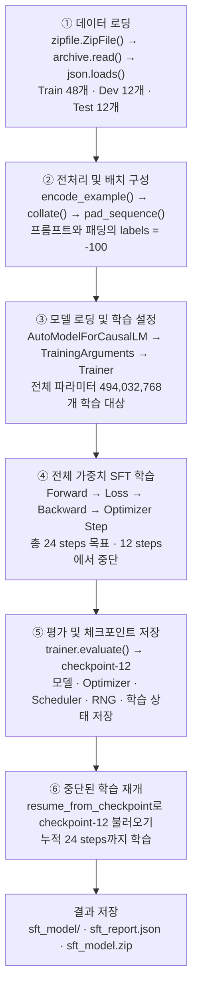

# TIL | LLM 전체 가중치 SFT 학습 및 체크포인트 복원

## 1. 오늘의 학습 목표

사전학습된 Qwen 모델을 SFT(Supervised Fine-Tuning) 방식으로 추가 학습시키고, 데이터 전처리부터 모델 학습, 평가, 체크포인트 복원까지의 전체 과정을 이해하는 것이 목표다.

특히 다음 3가지에 집중했다.

- 데이터 전처리: 어떤 토큰을 학습하고 손실에서 제외할지 결정
- 모델 학습: Forward → Loss → Backward → Optimizer Step
- 학습 재개: 가중치와 Optimizer, Scheduler 상태를 복원하여 이어서 학습

## 2. 전체 SFT 파이프라인


# 전체 가중치 SFT 학습 흐름

SFT(Supervised Fine-Tuning, 지도 미세조정)는 입력과 정답으로 구성된 예시를 이용해 모델을 추가 학습하는 과정입니다. 이 흐름에서는 **전체 파라미터 494,032,768개**를 학습 대상으로 설정하고, **총 24 steps 중 12 steps에서 중단한 뒤 체크포인트로 재개**합니다. Step은 모델 가중치를 한 번 갱신하는 단위입니다.

## 6단계 흐름도


### Mermaid 버전



## 단계별 설명

1. **데이터 로딩**: ZIP 파일을 열고 내부 파일을 읽은 뒤, JSON 데이터를 Python에서 다룰 수 있는 형태로 변환합니다. 데이터 구성은 Train(학습) 48개, Dev(검증) 12개, Test(최종 시험) 12개입니다.
2. **전처리 및 배치 구성**: 예시를 모델 입력으로 변환하고, 여러 예시를 하나의 배치로 묶습니다. 길이가 다른 입력은 패딩으로 맞춥니다. 정답 표시에 사용하는 `labels`에서 **프롬프트와 패딩 위치는 `-100`으로 설정해 손실 계산에서 제외**합니다. 해당 위치의 입력 자체를 삭제하는 것은 아닙니다.
3. **모델 로딩 및 학습 설정**: 다음 토큰을 예측하는 언어 모델을 불러오고, 학습 옵션과 학습 실행 도구인 `Trainer`를 구성합니다. 일부 파라미터만 조정하는 방식이 아니라, **전체 494,032,768개 파라미터를 학습 대상**으로 둡니다.
4. **전체 가중치 학습**: Forward(순전파)로 예측하고, Loss(손실)로 정답과의 차이를 계산합니다. Backward(역전파)로 각 파라미터의 조정 방향을 구한 뒤, Optimizer Step(최적화 갱신)으로 가중치를 바꿉니다. **목표는 24 steps이며, 12 steps에서 중단**합니다.
5. **평가 및 체크포인트 저장**: `trainer.evaluate()`로 평가하고, 학습을 이어갈 수 있도록 `checkpoint-12`에 상태를 저장합니다. 저장 항목은 아래 표와 같습니다. 제공된 흐름에는 평가 점수와 평가에 사용한 데이터가 명시되어 있지 않습니다.
6. **학습 재개 및 결과 저장**: `resume_from_checkpoint`로 `checkpoint-12`를 불러와 **누적 24 steps까지** 이어서 학습합니다. 24 steps를 추가로 수행한다는 뜻이 아닙니다. 마지막으로 아래 세 결과물을 저장합니다.

## checkpoint-12에 저장하는 상태

| 항목 | 역할 |
| --- | --- |
| 모델 | 12 steps까지 학습한 가중치 |
| Optimizer(최적화 도구) | 가중치 갱신을 이어가기 위한 내부 상태 |
| Scheduler(학습률 조절기) | 학습률 변화의 진행 상태 |
| RNG(Random Number Generator, 난수 생성기) | 무작위 처리의 흐름을 이어가기 위한 상태 |
| 학습 상태 | 현재 step 등 학습 진행 정보 |

## 최종 결과물

| 이름 | 내용 |
| --- | --- |
| `sft_model/` | 최종 학습 모델을 저장하는 폴더 |
| `sft_report.json` | 학습 결과를 정리하는 JSON 보고서 |
| `sft_model.zip` | 모델을 압축한 ZIP 파일 |

> 이 문서는 사용자가 제공한 학습 흐름을 시각화한 자료입니다. 실제 학습 실행, 체크포인트 내용 및 결과물 생성 여부를 확인한 실행 보고서는 아닙니다. Mermaid를 지원하는 Markdown 뷰어에서 흐름도가 표시됩니다.


## 3. 주요 라이브러리와 코드 역할

| 라이브러리/함수              | 핵심 역할               |
| --------------------- | ------------------- |
| `zipfile, json`       | 압축 데이터 읽기 및 JSON 변환 |
| `AutoTokenizer`       | 대화를 토큰 ID로 변환       |
| `encode_example()`    | 정답 구간 식별 및 Loss 마스킹 |
| torch, pad_sequence() | 텐서 생성 및 배치 패딩       |
| AutoModelForCausalLM  | 사전학습 모델 또는 체크포인트 로드 |
| TrainingArguments     | 학습률, 배치, 평가 및 저장 설정 |
| Trainer               | 모델 학습·평가·체크포인트 관리   |
| TrainerCallback       | 계획된 단계에서 학습 중단      |
| GenerationConfig      | 모델 답변 생성 옵션         |
| matplotlib            | Loss 및 학습률 시각화      |
| gc, torch.cuda        | 메모리 정리 및 GPU 관리     |

## 4. 핵심 코드와 개념 연결

### ① 전처리 - `encode_example()`

```python
prompt_ids = tokenizer.apply_chat_template(
	message[:2],
	tokenize=True,
	add_generation_prompt=True,
)

full_ids = tokenizer.apply_chat_template(
	messages,
	tokenize=True,
	add_generatrion_prompt=False,
)

# 프롬프트는 손실에서 제외하고 답변과 EOS만 학습
labels = [-100] * len(prompt_ids) + input_ids[len(prompt_ids):]
```

**핵심**: 모델은 프롬프트를 읽지만, 손실은 Assistant 답변과 EOS 토큰에 대해서만 계산한다.

`input_ids`와 `labels`의 역할은 다르다.

| 데이터            | 역할                        |
| -------------- | ------------------------- |
| input_ids      | 모델이 읽는 전체 토큰              |
| attention_mask | 실제 토큰 1, 패딩 0             |
| labels         | 학습할 정답 토큰과 손실 제외 위치(-100) |

### ② 배치 구성 - `collate(`)

```python
batch = collate([shortest, longest])
```

`pad_sequence()`는 길이가 서로 다른 데이터를 가장 긴 데이터에 맞춰 패딩한다.

- input_ids → PAD 토큰
- attention_mask → 0
- labels → -100

실습에서 검증한 배치 크기는 **(2,379)** 였다.

### ③ 모델 학습 - `Trainer.train()` 

```python
trainer = Trainer(
	model=model,
	args=args,
	train_dataset=encoded["train"],
	eval_dataset=encoded["dev"],
	data_collator=collate,
	processing_class=tokenizer,
)

trainer.train()
```

**Trainer는 학습을 관리하는 객체이며, `train()`이 실제 학습을 시작한다.**

![[Pasted image 20261118170529.png]]

| 설정                          | 값    |
| --------------------------- | ---- |
| TOTAL_STEPS                 | 24   |
| PAUSE_STEP                  | 12   |
| per_device_train_batch_size | 1    |
| gradient_accumulation_steps | 4    |
| learning_rate               | 2e-5 |
| warmup_steps                | 2    |
| eval_steps                  | 4    |
| save_steps                  | 12   |
유효 배치 = 1 x 4 = 4이므로 Train 48개를 한 번 학습하면 12 Steps, 두 번 학습하면 24 Steps다.

### ④ 체크포인트 저장 및 재개

```python
# 체크포인트 가중치 불러오기
model = AutoModelForCausalLM.from_pretrained(
	checkpoint,
	dtype=weight_dtype,
	attn_implementation="sdpa",
).to("cuda")

model.config.use_cache = False
trainer = make_trainer(model, args)

# 학습 상태까지 복원하여 이어서 학습
trainer.train(resume_from_checkpoint=str(checkpoint))

return model, trainer
```

**`from_pretrained()`와 `resume_from_checkpoint`의 차이가 가장 중요하다.**

- `from_pretrained(checkpoint)`: 저장된 모델 가중치 로드
- `resume_from_checkpoint`: Optimizer, Scheduler, Global Step 등을 복원하고 학습 재개

전체 목표가 24 Steps이므로 12 Steps에서 재개하면 **추가로 12 Steps만 학습한다.**

### 5. 학습 결과 및 평가

![[Pasted image 20261118172348.png]]

학습 후 JSON 형식 준수는 12/12, 업무 판단 정답은 10/12 였다.

**Loss가 낮다고 실제 답변의 정확성이 보장되는 것은 아니라는 점**을 보여준다.

- `trainer.evaluate()`: 모범답안을 이용한 정답 토큰 손실 측정
- `generate_probe()`: 모범답안 없이 모델이 생성한 실제 답변 확인

따라서 두 평가를 함께 사용해야 한다.

### 6. 오늘 배운 핵심

1. `encode_example()`은 무엇을 학습할지 결정하고, `collate()`는 그 데이터로 배치로 묶는다. 
2. `Trainer.train()`은 **Forward → Loss → Backward → Optimizer Step 과정을 관리하여 가중치를 업데이트한다.**
3. 체크포인트는 모델 가중치뿐 아니라 학습 상태까지 저장해야 정확한 재개가 가능하다.
4. Train/Dev Loss는 토큰 예측에 대한 지표이며, 실제 답변의 판단 정확도와 구분해야 한다.

이번 학습을 통해 **데이터 전처리 → 전체 가중치 SFT → 학습 상태 평가 → 체크포인트 복원 → 최종 모델 저장**까지의 연결 구조를 이해했다. 

다음에는 특히 **Gradient Accumulation이 실제 Backward와 Optimizer Step을 어떻게 연결하는지, 그리고 Full Fine-Tuning과 LoRA에서 업데이트되는 파라미터가 어떻게 다른지**를 비교하면 좋겠다. 
