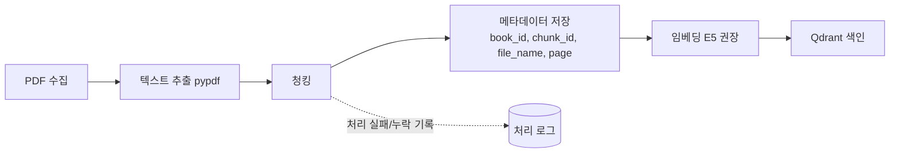
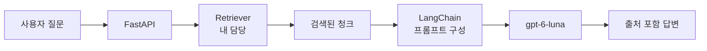
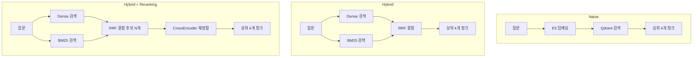
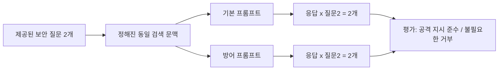
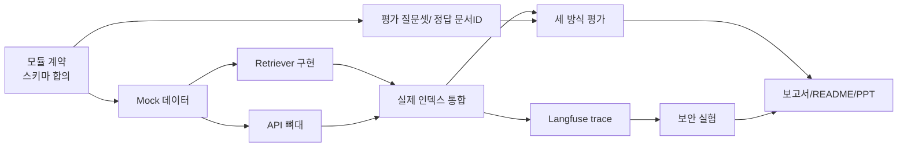

# KANT PROJECT 3 통합 가이드
### PDF 기반 RAG Q&A 서비스 구축 및 검색 방식 비교 (Retriever 담당자용 복습 교재)

> 작성 기준일: 2026-11-05 (목) / 제출: 2026-11-13 (금) 13:00 KST
>
> **읽는 법 (표기 규칙)**
> - `[확정]` 사용자가 제공한 프로젝트 정보로 확인된 내용
> - `[권장]` 권장 분담/권장 기술/제안 사항 (확정 사실이 아님)
> - `[Mock]` 가짜(임시) 데이터. 실제 프로젝트 데이터가 아님
> - `[예시 출력]` 설명용으로 만든 출력. **실제 실행 결과나 측정값이 아님**
> - 프로젝트 발제문이나 팀 스키마가 확정되면 **그 문서가 이 가이드보다 우선**합니다.

---

## 목차

0. 프로젝트 한눈에 보기
1. 프로젝트 기본 정보
2. 전체 개념 설명
3. 시스템 아키텍처 (Mermaid)
4. 4인 팀 모듈별 역할
5. PDF 데이터 처리와 출처 관리
6. Retriever 집중 설명
7. Retriever 개발 순서 (STEP 1~10)
8. Retriever 평가 지표
9. 공정한 세 가지 방식 비교
10. 대상·조건 확인과 답변 보류
11. 보안·프롬프트 인젝션 평가
12. Langfuse와 LLMOps
13. Retriever 산출물과 리포트
14. 전체 일정 (제안안)
15. 최종 제출물
16. 학습 복습 자료

---

## 0. 프로젝트 한눈에 보기 (가장 먼저 읽기)

**쉬운 말로 목표**

> "PDF 문서들을 읽어서 질문에 답해 주는 서비스를 만든다. 그런데 문서를 찾는 방법(검색)을 세 가지로 만들어 보고, 똑같은 조건에서 비교해서 가장 좋은 방법을 고른다."

| 구분 | 내용 |
|---|---|
| 만드는 것 | PDF를 근거로 답하고 출처(파일명, 페이지)를 보여주는 Q&A 서비스 |
| 비교하는 것 | Naive RAG, Hybrid RAG, Hybrid + Reranking |
| 증명할 것 | "어떤 검색 구성이 정확도, 속도, 안정성 면에서 가장 좋은가"를 **데이터로** 보여주기 |
| 내 역할 | **Retriever 모듈**: 질문이 들어오면 관련 청크를 찾아 일정한 형식으로 돌려주는 부분 |

**전체 프로젝트 vs 내 파트**

| 구분 | 전체 프로젝트 | 내가 담당하는 Retriever |
|---|---|---|
| 범위 | 데이터 처리, 검색, API, LLM 답변, 평가, 관측, 보안 실험, 발표 | Dense, BM25, Hybrid(RRF), Reranker, 공통 `retrieve()` |
| 입력 | PDF | 팀원 1이 만든 청크와 Qdrant 인덱스 `[확정]` |
| 출력 | 출처 포함 답변과 비교 리포트 | 순위가 매겨진 청크 리스트 |
| 하지 않는 일 | - | PDF 파싱, 청킹, 인덱스 구축(팀원 1), 최종 답변 생성(LLM/팀원 3) |

**필수 vs 권장 기술**

| 구분 | 기술 |
|---|---|
| 필수 `[확정]` | Python, pypdf, LangChain, FastAPI, Pydantic, BM25, RRF, CrossEncoder Reranker 등, gpt-6-luna, Langfuse, RAGAS, LLM-as-a-Judge |
| 권장 `[확정: 권장일 뿐 필수 아님]` | **E5 임베딩**, **Qdrant** |

E5와 Qdrant는 "이걸 쓰면 편하고 팀 합의가 쉽다" 수준의 권장입니다. 다른 임베딩 모델/벡터 DB를 써도 규칙을 어기는 것이 아니지만, 세 방식 모두 **같은 것을 써야** 비교가 공정합니다.

---

## 1. 프로젝트 기본 정보

| 항목 | 내용 |
|---|---|
| 프로젝트명 | KANT PROJECT 3 |
| 유형 | PDF 기반 RAG Q&A 시스템 |
| 팀원 수 | 4명 |
| 개발 방식 | 기능별 모듈화 후 통합 |
| 시작일 | 2026-11-05 (목) |
| 제출일 | 2026-11-13 (금) 13:00 KST |
| 핵심 목표 | 세 가지 RAG 검색 방식을 구현, 동일 조건 평가, 최적 구성 선정 |

**필수 검색 방식 3가지**

| # | 이름 | 한 줄 설명 |
|---|---|---|
| 1 | Naive RAG | 질문을 벡터로 바꿔 의미가 비슷한 청크를 찾는 Dense 검색만 사용 |
| 2 | Hybrid RAG | Dense + BM25(키워드) 결과를 RRF로 합침 |
| 3 | Hybrid + Reranking | Hybrid로 후보를 넉넉히 뽑고, CrossEncoder로 다시 정밀 정렬 |

**기술 스택 요약**

| 기술 | 역할 | 필수/권장 |
|---|---|---|
| Python | 구현 언어 | 필수 |
| pypdf | PDF 텍스트 추출 | 필수(스택 명시) |
| LangChain | 검색 결과 + 프롬프트 + LLM 연결 | 필수(스택 명시) |
| FastAPI | HTTP API 서버 | 필수(스택 명시) |
| Pydantic | 요청/응답 스키마 검증 | 필수(스택 명시) |
| E5 Embedding | 텍스트를 벡터로 변환 | **권장** |
| Qdrant | 벡터 저장/검색 | **권장** |
| BM25 | 키워드 기반 검색 | 필수(검색 방식에 포함) |
| RRF | 여러 검색 순위 합치기 | 필수(Hybrid에 포함) |
| CrossEncoder | 재정렬 | 필수(Reranking에 포함, 모델은 선택) |
| gpt-6-luna | 답변 생성 LLM | 스택 명시 |
| Langfuse | 실행 추적/관측 | 스택 명시 |
| RAGAS, LLM-as-a-Judge | 답변 품질 평가 | 스택 명시 |

---

## 2. 전체 개념 설명 (개념 → 이유 → 예시)

### 2-1. 우리가 만드는 서비스

- **개념**: 사용자가 질문하면 미리 넣어둔 PDF에서 관련 부분을 찾고, 그 내용을 근거로 답하며, 출처(파일명, 페이지)를 같이 보여주는 서비스.
- **이유**: 답이 맞는지 사용자가 직접 PDF에서 확인할 수 있어야 업무에 쓸 수 있습니다.
- **예시**
  - 질문: "A 선사의 11월 냉동 컨테이너 연체료는 얼마인가요?"
  - 답변: "하루 USD 120입니다. (출처: shipping_tariff_2026.pdf, p.14)"

### 2-2. 일반 LLM 챗봇 vs RAG 챗봇

- **개념**: 일반 챗봇은 학습 때 본 지식으로만 답합니다. RAG는 답하기 전에 **외부 자료를 검색해서 프롬프트에 붙여** 줍니다. (RAG = Retrieval-Augmented Generation, 검색 증강 생성)
- **이유**: LLM은 우리 회사 PDF를 본 적이 없고, 모르는 걸 그럴듯하게 지어내기(환각) 때문입니다.
- **예시**

| 구분 | 일반 챗봇 | RAG 챗봇 |
|---|---|---|
| 질문 | "우리 장비 X-200의 점검 주기는?" | 같음 |
| 동작 | 기억에 의존해 추측 | 매뉴얼 PDF에서 관련 청크 검색 후 답변 |
| 결과 | 틀려도 자신 있게 답함 | 근거와 출처 제시, 근거 없으면 "모르겠다" 가능 |

### 2-3. PDF를 외부 지식으로 쓰는 이유

- **개념**: PDF(규정집, 매뉴얼, 약관 등)를 LLM 바깥의 "지식 창고"로 둡니다.
- **이유**: (1) 모델 재학습 없이 지식 교체 가능 (2) 최신 문서 반영 쉬움 (3) 출처 추적 가능.
- **예시**: 새 약관 PDF를 추가하면 다음 질문부터 바로 반영됩니다. 모델을 다시 훈련할 필요가 없습니다.

### 2-4. 검색 정확도가 답변 품질에 영향을 주는 이유

- **개념**: LLM은 **받은 문맥 안에서** 답합니다. 엉뚱한 청크를 받으면 엉뚱한 답이 나옵니다.
- **이유**: 검색이 틀리면 뒤 단계(LLM, 프롬프트)를 아무리 잘 만들어도 못 고칩니다. "Garbage in, garbage out."
- **예시**
  - 질문: "2025년 수수료율은?"
  - 검색이 2024년 표를 가져오면, LLM은 2024년 수치로 자신 있게 답할 수 있습니다.

### 2-5. Naive, Hybrid, Reranking을 비교하는 목적

- **개념**: 검색 방식이 단순한 것에서 복잡한 것으로 갈수록 정확도가 오를 가능성이 있지만 **느려지고 복잡**해집니다.
- **이유**: "복잡한 게 항상 좋다"는 가정은 검증이 필요합니다. 데이터에 따라 Naive로도 충분할 수 있습니다.
- **예시**: 모델명, 조항 번호(예: "제12조 3항")처럼 정확한 문자열이 중요한 질문은 BM25가 강할 수 있고, 돌려 말한 질문은 Dense가 강할 수 있습니다. 합치면(Hybrid) 둘 다 커버할 가능성이 있습니다. 실제 결과는 **측정해야** 압니다.

### 2-6. 프로젝트가 최종적으로 증명해야 하는 것

- **개념**: "세 방식 중 어떤 구성이 우리 데이터에서 최적인가"를 **수치와 근거**로 설명.
- **이유**: 느낌이 아니라 재현 가능한 실험이 엔지니어링의 핵심이기 때문입니다.
- **예시**: "Hybrid + Reranking은 Hit@5가 X만큼 높지만 p95 지연이 Y ms 늘었다. 따라서 Z 구성을 선택한다."(X, Y, Z는 측정 후 채움)

---

## 3. 시스템 아키텍처 (Mermaid)

### A. 데이터 전처리 파이프라인 (팀원 1 담당 `[확정]`)



**쉬운 설명**: PDF를 모아서 글자를 뽑고, 적당한 크기로 자른 뒤(청크), 각 조각에 "어느 파일 몇 쪽인지" 꼬리표를 붙입니다. 그 조각을 숫자 벡터로 바꿔 Qdrant에 저장합니다. 읽기에 실패한 PDF나 페이지는 로그로 남깁니다.

### B. 실시간 RAG 파이프라인



**쉬운 설명**: 질문이 API로 들어오면 Retriever가 관련 청크를 찾고, LangChain이 "질문 + 청크"를 프롬프트로 묶어 LLM에 보냅니다. LLM의 답변에 출처를 붙여 응답합니다.

### C. 세 가지 검색 방식 내부 구조



**쉬운 설명**
- Naive: 의미로만 찾기.
- Hybrid: 의미로 찾은 목록과 키워드로 찾은 목록을 순위 기준으로 합치기.
- Hybrid + Reranking: 합친 목록에서 후보를 넉넉히(예: 20~50개) 뽑고, "질문과 청크를 같이 읽는" 정밀 모델이 다시 줄 세워 최종 k개(예: 5개)만 사용.

### D. 평가 및 관측 파이프라인

```mermaid
flowchart LR
    RS[검색 결과] --> M1[Hit@k / Recall@k]
    GA[생성 답변] --> M2[RAGAS / LLM Judge]
    RUN[실제 실행] --> M3[Langfuse<br/>Trace / Latency / Token / Error]
    M1 --> REP[비교 리포트]
    M2 --> REP
    M3 --> REP
```

**쉬운 설명**: 검색은 "정답 문서를 찾았나"(Hit/Recall)로, 답변은 "근거에 충실한가"(RAGAS, Judge)로, 운영은 "얼마나 빠르고 안 깨지는가"(Langfuse)로 각각 점수를 매기고 하나의 리포트로 모읍니다.

---

## 4. 4인 팀 모듈별 역할

| 담당 | 모듈 | 주요 업무 | 상태 |
|---|---|---|---|
| 팀원 1 | Data Processing | PDF 추출, 청킹, 임베딩, Qdrant 인덱스 구축 및 입출력 형식 정의 | **합의됨** `[확정]` |
| 팀원 2 (본인) | Retriever | Dense, BM25, Hybrid, Reranking | **합의됨** `[확정]` |
| 팀원 3 | RAG Service / API | FastAPI, LangChain, LLM 답변, 출처 검증 | `[권장]` 아직 확정 아님 |
| 팀원 4 | Evaluation / LLMOps | 검색·답변 평가, Langfuse, 결과 분석 | `[권장]` 아직 확정 아님 |

> 팀원 3, 4의 분담은 권장안입니다. 실제 합의 전에 팀원들과 꼭 확인하세요.

### 모듈별 상세

#### 팀원 1: Data Processing
| 항목 | 내용 |
|---|---|
| 입력 | 원본 PDF 파일들 |
| 내부 처리 | 텍스트 추출, 청킹(size/overlap), 메타데이터 부여, 임베딩, Qdrant 업로드, 실패 로그 |
| 출력 | 청크 JSONL, Qdrant 컬렉션, 처리 로그 |
| 기술 | pypdf, (LangChain TextSplitter), E5(권장), Qdrant(권장) |
| 연결 | 내 Retriever에 청크 스키마/컬렉션명/임베딩 모델명/payload 필드 제공 |
| 완료 기준 | 모든 PDF의 처리 성공/실패가 기록되고, 청크 수와 Qdrant 포인트 수가 일치 |

#### 팀원 2 (본인): Retriever
| 항목 | 내용 |
|---|---|
| 입력 | 질문 문자열, 모드(`naive`/`hybrid`/`rerank`), k, 청크 데이터와 Qdrant |
| 내부 처리 | Dense 검색, BM25 검색, RRF 결합, 중복 제거, CrossEncoder 재정렬, 지연시간 측정 |
| 출력 | 일관된 스키마의 순위 청크 리스트(+ 시간/오류 정보) |
| 기술 | sentence-transformers(E5), qdrant-client, rank_bm25, CrossEncoder, Pydantic |
| 연결 | 팀원 1(스키마/인덱스 수신), 팀원 3(`retrieve()` 호출), 팀원 4(결과/로그 제공) |
| 완료 기준 | 세 모드 모두 같은 스키마 반환, 단위 테스트 통과, 실제 Qdrant로 교체 후 동작, 평가 파일 3종 산출 |

#### 팀원 3: RAG Service / API `[권장]`
| 항목 | 내용 |
|---|---|
| 입력 | 사용자 질문, Retriever 결과 |
| 내부 처리 | 프롬프트 구성, gpt-6-luna 호출, 답변 상태 결정, 출처 검증 |
| 출력 | `answered / needs_clarification / abstained / error` + 답변 + 출처 |
| 기술 | FastAPI, LangChain, Pydantic |
| 연결 | 내 `retrieve()`를 호출, Langfuse로 trace 전달 |
| 완료 기준 | `/ask` API가 세 모드를 전환 실행하고 출처가 실제 청크와 일치 |

#### 팀원 4: Evaluation / LLMOps `[권장]`
| 항목 | 내용 |
|---|---|
| 입력 | 평가 질문셋(정답 문서 ID 포함), 검색 결과, 답변 |
| 내부 처리 | Hit@k/Recall@k, RAGAS, LLM Judge, Langfuse 연동, 보안 실험 |
| 출력 | 지표 CSV, 비교 리포트, trace |
| 기술 | RAGAS, Langfuse, LLM Judge |
| 연결 | 내 검색 결과 파일과 로그를 입력으로 사용 |
| 완료 기준 | 세 방식이 동일 조건에서 평가되어 표로 비교 가능 |

---

## 5. PDF 데이터 처리와 출처 관리

> 이 장은 팀원 1의 영역이지만, Retriever가 입력을 이해하려면 알아야 합니다.

### 5-1. 핵심 개념

| 용어 | 쉬운 설명 | 왜 필요한가 |
|---|---|---|
| PDF 텍스트 추출 | PDF에서 글자를 꺼내는 일 (pypdf) | 검색은 텍스트로 하기 때문 |
| 청킹(Chunking) | 긴 문서를 작은 조각으로 자름 | 검색 단위를 작게 해야 정확하고 LLM 입력에 들어감 |
| Chunk Size | 조각 하나의 크기 (글자/토큰 수) | 너무 크면 잡음, 너무 작으면 문맥 손실 |
| Overlap | 인접 조각이 겹치는 길이 | 경계에서 문장이 잘려 의미가 사라지는 것을 방지 |
| 임베딩 | 글을 숫자 벡터로 변환 | 의미가 비슷한 글은 가까운 벡터가 됨 |
| Vector DB | 벡터를 저장하고 가까운 것을 빠르게 찾는 DB | 수만 개 이상에서도 빠른 유사도 검색 |
| Metadata | 청크에 붙는 꼬리표 | 출처 표시, 필터, 평가에 사용 |

### 5-2. 필드 정의 (예시, 팀 스키마가 우선)

| 필드 | 의미 |
|---|---|
| `book_id` | 문서(PDF) 단위 ID. **Hit/Recall 평가는 보통 이 단위** |
| `chunk_id` | 청크 고유 ID |
| `file_name` | 원본 파일명 (출처 표시용) |
| `page` | 페이지 번호 (출처 표시용) |
| `content` | 청크 본문 |

### 5-3. 샘플 청크 JSON `[Mock]`

```json
{
  "book_id": "BOOK_SHIP_001",
  "chunk_id": "BOOK_SHIP_001_p14_c02",
  "file_name": "shipping_tariff_2026.pdf",
  "page": 14,
  "content": "냉동 컨테이너(Reefer) 연체료는 무료 기간 종료 후 1일당 USD 120이 부과된다. (기준일: 2026-11-01 예약분부터)"
}
```

### 5-4. 질문별 답변

**Q1. PDF 전체를 그대로 검색하지 않고 청킹하는 이유는?**
- 개념: 문서를 조각내어 조각 단위로 검색.
- 이유: (1) 300쪽 문서 전체는 LLM 입력 한도를 넘음 (2) 한 문서에 여러 주제가 섞여 의미 벡터가 흐려짐 (3) 정확히 어느 부분이 근거인지 지정 불가.
- 예시: "연체료"를 물으면 300쪽 책 전체가 아니라 14쪽의 해당 단락 하나만 필요합니다.

**Q2. 파일명과 페이지를 보존하는 이유는?**
- 이유: 출처 표시와 검증, 평가(정답 문서 일치 확인), 오류 추적 때문.
- 예시: 답변에 "(shipping_tariff_2026.pdf, p.14)"가 있으면 사용자가 바로 원문을 확인할 수 있습니다.

**Q3. PDF 처리 누락과 실패를 기록하는 이유는?**
- 이유: 스캔본 PDF, 암호화, 깨진 글자 때문에 일부가 **조용히 빠지면** "검색이 못 찾은 것"과 "애초에 인덱스에 없는 것"을 구분할 수 없습니다.
- 예시: 평가에서 Hit@5가 낮게 나왔는데 원인이 알고리즘이 아니라 해당 PDF가 추출 실패였다면, 로그가 있어야 알아챕니다.

**Q4. 표의 행·열·단위·각주를 보존해야 하는 이유는?**
- 이유: 표는 "행 이름 + 열 이름 + 단위"가 합쳐져야 의미가 생깁니다. 숫자만 남으면 무엇의 값인지 알 수 없습니다. 각주에 "단, 2026-11-01 이후 예약분" 같은 조건이 있을 수 있습니다.
- 예시: `120` 한 칸만 있으면 USD인지 KRW인지, 일당인지 월당인지 알 수 없음. 표를 `"냉동 컨테이너 | 연체료 | USD/일 | 120 | *11/1 이후 예약분"`처럼 한 줄로 풀어 저장하면 안전합니다.

**Q5. 검색용 데이터와 평가용 데이터를 분리해야 하는 이유는?**
- 이유: 정답 문서 ID 같은 평가 정보가 검색 인덱스/프롬프트에 섞이면 **정답을 미리 알려주는 누수(leakage)** 가 생겨 점수가 부풀려집니다.
- 예시: 청크 payload에 `gold_question`이 들어 있으면 안 됩니다. 평가 질문셋은 별도 파일(`eval_questions.jsonl`)로 관리합니다.

---

## 6. Retriever 집중 설명 (가장 상세)

### 6-1. Retriever 역할

- **개념**: 질문을 받아 "답에 필요할 법한 청크"를 순위대로 돌려주는 모듈. RAG에서 **도서관 사서** 역할입니다. 사서는 책을 골라주고, 읽고 정리하는 건 LLM의 일입니다.
- **이유**: LLM에 PDF 전체를 넣을 수 없고, 넣어도 비용과 정확도 문제가 생깁니다.
- **연결**: `FastAPI → retrieve() → 청크 리스트 → LangChain → LLM`.

```text
입력: query="냉동 컨테이너 연체료", mode="hybrid", k=5
출력: [청크1(1위), 청크2(2위), ... 청크5(5위)]  (각 청크에 출처 메타데이터 포함)
```

| 책임 | Retriever | LLM / 서비스 |
|---|---|---|
| 관련 청크 찾기 | O | - |
| 순위/점수 부여 | O | - |
| 답변 문장 작성 | - | O |
| "정보 부족이라 답변 보류" 판단 | 신호만 제공(점수, 결과 없음) | 최종 판단 |

### 6-2. Dense Retriever

| 개념 | 쉬운 설명 |
|---|---|
| Dense 검색 | 의미를 숫자 벡터로 바꿔 "뜻이 가까운" 청크를 찾음 |
| E5 `query:` / `passage:` 접두어 | E5 모델은 질문 앞에 `query: `, 문서 앞에 `passage: `를 붙여 학습됨. **붙이지 않으면 성능이 떨어질 수 있음**. 청크 임베딩(팀원 1)과 질문 임베딩(나)이 규칙이 맞아야 함 |
| Cosine Similarity | 두 벡터의 방향이 얼마나 비슷한지(−1~1). 클수록 비슷 |
| Top-k | 점수 높은 순으로 k개만 반환 |
| 반환 | 점수 + payload(메타데이터와 본문) |

> **팀원 1에게 확인할 것**: 청크 임베딩 때 `passage: ` 접두어를 썼는지, 정규화(normalize)했는지, 컬렉션 거리 설정이 Cosine인지, 모델명이 정확히 무엇인지.

**예시 동작 (개념)**
```text
질문: "냉동 컨테이너 연체료가 얼마야?"
-> "query: 냉동 컨테이너 연체료가 얼마야?" -> 벡터
-> Qdrant에서 코사인 유사도 상위 k개
-> "Reefer 연체료는 1일당 USD 120" 청크가 상위에 올 가능성 (단어가 달라도 의미가 비슷하기 때문)
```

### 6-3. BM25 Retriever

- **키워드 검색**: 질문에 나온 단어가 청크에 **실제로 들어 있는지**로 점수를 매김.
- **BM25 원리(쉬운 버전)**
  1. 질문 단어가 청크에 많이 나올수록 점수 상승 (TF)
  2. 모든 청크에 흔한 단어("은/는/the")는 영향이 작고, 드문 단어는 영향이 큼 (IDF)
  3. 긴 청크는 단어가 많이 나올 수 밖에 없으므로 길이를 보정
- **한국어 토큰화 주의**
  - 한국어는 조사가 붙음: "연체료는", "연체료가", "연체료를" → 단순 공백 분리 시 서로 다른 단어로 취급됨.
  - 대안: (1) 형태소 분석기(kiwipiepy, Mecab 등) `[권장]` (2) 문자 n-gram(2-gram) 사용: 설치 간단하고 조사에 강함 (3) 영문/숫자 모델명은 그대로 보존(예: `X-200`, `제12조`).
  - 질문과 청크에 **같은 토큰화 함수**를 써야 합니다.
- **점수**: BM25 점수는 0 이상의 실수이며 **절대 크기에 의미가 없음**(Dense 점수와 단위가 다름). 그래서 합칠 때 점수 대신 **순위**를 쓰는 RRF가 유용합니다.
- **반환**: Dense와 같은 스키마.

### 6-4. Hybrid Retriever

| 구분 | Dense | BM25 |
|---|---|---|
| 강점 | 비슷한 의미, 다른 표현(동의어, 돌려 말하기) | 정확한 단어, 모델명, 조항 번호, 고유명사 |
| 약점 | 정확한 코드/숫자에 약할 수 있음 | 표현이 다르면 못 찾음 |
| 점수 | 코사인(−1~1) | BM25(0~무한) |

**RRF (Reciprocal Rank Fusion)**

```text
RRF_score(d) = Σ  1 / (c + rank_i(d))       (c는 보통 60, rank는 1부터)
```

- 각 검색 목록에서 문서의 **순위**만 사용. 여러 목록에서 상위에 있으면 점수가 합쳐져 올라감.
- 한쪽에만 있어도 점수를 받음.
- **계산 예시** (c=60)

| 청크 | Dense 순위 | BM25 순위 | RRF 점수 |
|---|---|---|---|
| A | 1 | 3 | 1/61 + 1/63 = 0.01639 + 0.01587 = **0.03226** |
| B | 2 | 1 | 1/62 + 1/61 = 0.01613 + 0.01639 = **0.03252** |
| C | 3 | - | 1/63 = **0.01587** |
| D | - | 2 | 1/62 = **0.01613** |

최종 순위: B > A > D > C. (이 계산은 공식 적용 예시입니다.)

- **중복 청크 제거**: 같은 `chunk_id`는 한 번만 남기고 점수를 합산. 같은 문서의 서로 다른 청크는 별개 청크로 유지(문서 단위 중복 제거는 평가 때 별도로 수행).
- **순위 통합**: 합산 점수 내림차순 정렬 후 상위 k(또는 후보 N)개 반환.

### 6-5. Reranker

| 개념 | 설명 |
|---|---|
| Reranking | 1차 검색 결과를 더 정밀한 모델로 **다시 줄 세우기** |
| Bi-Encoder(Dense 검색) | 질문과 청크를 **따로** 벡터로 만든 뒤 비교. 빠르지만 대략적 |
| CrossEncoder | 질문과 청크를 **한 쌍으로 함께** 모델에 넣어 관련도 점수 산출. 정확하지만 느림 |
| 후보 청크 vs 최종 k | 후보(예: 30개)를 뽑고 CrossEncoder로 점수 매겨 상위 k(예: 5개)만 LLM에 전달 |
| 정확도와 지연 | 후보 수가 클수록 놓칠 가능성은 줄지만 CrossEncoder 호출이 후보 수만큼 늘어 **지연 증가**. 후보 수는 실험으로 정하는 하이퍼파라미터 |

**비유**: 1차 검색은 서류 심사, Reranker는 후보자 전원 면접. 면접은 정확하지만 인원이 많으면 오래 걸립니다.

모델 선택 `[권장 / 확정 아님]`: 다국어 지원 CrossEncoder(예: `BAAI/bge-reranker-v2-m3`, 또는 더 가벼운 다국어 모델)를 후보로 비교. **한국어 지원 여부와 로컬 실행 가능 여부를 반드시 확인**하세요.

### 6-6. 공통 검색 인터페이스

```python
retrieve(
    query="사용자 질문",
    mode="hybrid",   # "naive" | "hybrid" | "rerank"
    k=5
)
```

- 세 모드의 반환 형식이 **완전히 같아야** 서비스/평가 코드가 모드에 상관없이 동작합니다.
- **팀원이 확정한 스키마가 있으면 그 형식을 우선**합니다. 아래는 내가 제안할 초안입니다.

```json
{
  "request_id": "req_0001",
  "query": "냉동 컨테이너 연체료는?",
  "mode": "hybrid",
  "k": 5,
  "latency_ms": 48.2,
  "error": null,
  "results": [
    {
      "rank": 1,
      "chunk_id": "BOOK_SHIP_001_p14_c02",
      "book_id": "BOOK_SHIP_001",
      "file_name": "shipping_tariff_2026.pdf",
      "page": 14,
      "content": "냉동 컨테이너(Reefer) 연체료는 ...",
      "score": 0.0325,
      "source": "hybrid"
    }
  ]
}
```

---

## 7. Retriever 개발 순서 (STEP 1~10)

> 아래 데이터는 모두 **[Mock]** 입니다. 실행 결과는 **[예시 출력]** 이며 실제 실행값이 아닙니다.
> 코드는 설명용 초안이므로 환경(라이브러리 버전)에 맞게 수정/검증이 필요합니다.

### STEP 1. 임시 청크 데이터 확인

- **목적**: 팀원 1의 실제 데이터가 오기 전에, 약속된 형식의 가짜 데이터로 먼저 개발 시작.
- **입력**: Mock 청크 JSONL
- **구현**: 필수 필드 존재 여부, 빈 본문, 중복 chunk_id 확인.

`data/mock_chunks.jsonl` `[Mock]`
```json
{"book_id":"BOOK_FIN_001","chunk_id":"FIN001_p03_c01","file_name":"fin_fee_policy.pdf","page":3,"content":"A사 신용카드 연회비는 2026년 1월 1일부터 12월 31일까지 15,000원이다."}
{"book_id":"BOOK_FIN_001","chunk_id":"FIN001_p04_c01","file_name":"fin_fee_policy.pdf","page":4,"content":"A사 해외결제 수수료는 1.0%이며 2025년 기준 0.8%에서 인상되었다."}
{"book_id":"BOOK_MFG_001","chunk_id":"MFG001_p07_c01","file_name":"x200_manual.pdf","page":7,"content":"X-200 장비의 윤활유 교체 주기는 500시간이다. 단, 옵션 팩 B 장착 모델은 300시간."}
{"book_id":"BOOK_SHIP_001","chunk_id":"SHIP001_p14_c02","file_name":"shipping_tariff_2026.pdf","page":14,"content":"냉동 컨테이너(Reefer) 연체료는 무료 기간 종료 후 1일당 USD 120이 부과된다. 2026-11-01 예약분부터 적용."}
{"book_id":"BOOK_SHIP_001","chunk_id":"SHIP001_p15_c01","file_name":"shipping_tariff_2026.pdf","page":15,"content":"일반 건화물 컨테이너 연체료는 1일당 USD 60이다."}
```

```python
# check_chunks.py
import json                                   # JSON 읽기용 표준 라이브러리
from collections import Counter               # 중복 개수 세기용

REQUIRED = ["book_id", "chunk_id", "file_name", "page", "content"]  # 필수 필드 목록

def load_chunks(path: str) -> list[dict]:
    chunks = []
    with open(path, encoding="utf-8") as f:     # 한글이 깨지지 않게 utf-8로 열기
        for line_no, line in enumerate(f, 1):   # 줄 번호를 1부터 세기(오류 위치 표시용)
            if not line.strip():                # 빈 줄은 건너뜀
                continue
            row = json.loads(line)              # 한 줄(JSON)을 dict로 변환
            missing = [k for k in REQUIRED if k not in row]  # 빠진 필드 찾기
            if missing:
                raise ValueError(f"{line_no}번째 줄에 필드 누락: {missing}")
            if not str(row["content"]).strip(): # 본문이 비어 있으면 검색 불가
                raise ValueError(f"{line_no}번째 줄 content 비어 있음")
            chunks.append(row)
    dup = [cid for cid, n in Counter(c["chunk_id"] for c in chunks).items() if n > 1]
    if dup:                                      # chunk_id는 고유해야 함
        raise ValueError(f"중복 chunk_id: {dup}")
    return chunks

if __name__ == "__main__":
    chunks = load_chunks("data/mock_chunks.jsonl")
    print(f"청크 {len(chunks)}개 확인, 문서 {len({c['book_id'] for c in chunks})}개")
```

- **[예시 출력]** `청크 5개 확인, 문서 3개`
- **발생 가능 오류**: 인코딩 오류(utf-8 아님), 필드명 불일치(`filename` vs `file_name`), page가 문자열, 중복 ID
- **완료 기준**: 검증 스크립트 통과 + 필드명/타입을 팀원 1과 문서로 합의

### STEP 2. 폴더 구조 및 개발 환경

- **목적**: 모듈을 분리해 테스트하기 쉽게 구성.
- **구현**

```text
retriever/
├─ data/
│  ├─ mock_chunks.jsonl         # [Mock] 임시 데이터
│  └─ eval_questions.jsonl      # 평가 질문(팀원 4와 공유)
├─ src/retriever/
│  ├─ __init__.py
│  ├─ schema.py                 # 공통 스키마
│  ├─ dense.py
│  ├─ bm25.py
│  ├─ hybrid.py
│  ├─ reranker.py
│  └─ service.py                # retrieve() 통합
├─ tests/test_retriever.py
├─ outputs/                     # retrieval_results.jsonl 등 결과
├─ reports/                     # 보고서 4종
├─ requirements.txt
└─ README.md
```

```text
# requirements.txt (버전은 팀에서 고정할 것)
pydantic
rank-bm25
sentence-transformers
qdrant-client
pytest
# kiwipiepy   # 한국어 형태소 분석기(선택)
```

- **발생 가능 오류**: 패키지 충돌, GPU 없음(CPU로도 동작하나 느림), 모델 다운로드 실패(네트워크)
- **완료 기준**: `pip install -r requirements.txt` 후 `pytest`가 빈 테스트라도 실행됨, 버전 고정

### STEP 3. 공통 스키마 및 함수 인터페이스 확인

- **목적**: 팀원 3, 4가 모드에 상관없이 같은 방식으로 쓸 수 있게 형식 고정.

```python
# src/retriever/schema.py
from typing import Literal, Optional
from pydantic import BaseModel, Field          # 데이터 검증용

Mode = Literal["naive", "hybrid", "rerank"]    # 허용되는 검색 모드 3가지

class Chunk(BaseModel):                        # 청크 한 개의 형식
    chunk_id: str
    book_id: str
    file_name: str
    page: int
    content: str

class RetrievedChunk(Chunk):                   # 검색된 청크 = 청크 + 순위/점수
    rank: int = Field(ge=1)                    # 1 이상의 순위
    score: float                               # 모드별 점수(비교용 아님, 참고용)
    source: str                                # 어떤 방식이 만든 결과인지

class RetrievalResponse(BaseModel):            # retrieve()의 최종 반환
    request_id: str
    query: str
    mode: Mode
    k: int
    latency_ms: float                          # Retriever 내부 검색 시간만
    results: list[RetrievedChunk]
    error: Optional[str] = None                # 실패 시 메시지, 정상이면 None
```

- **[예시 출력]** `RetrievalResponse(...)`가 잘못된 mode("fuzzy")를 받으면 ValidationError.
- **오류**: 팀 스키마와 필드명 불일치 → **팀 스키마가 확정되면 이 파일만 수정**하도록 설계.
- **완료 기준**: 팀원 3, 4가 스키마 문서에 동의(채팅/문서에 기록)

### STEP 4. BM25 검색 구현

- **목적**: 외부 서비스 없이 바로 돌아가는 키워드 검색 먼저 완성(가장 빨리 검증 가능).
- **입력**: 청크 리스트, 질문
- **구현**: 토큰화 → BM25 인덱스 → 점수 → 상위 k.

```python
# src/retriever/bm25.py
import re
from rank_bm25 import BM25Okapi               # BM25 구현체

def tokenize(text: str) -> list[str]:
    text = text.lower()                                  # 영문 대소문자 통일
    words = re.findall(r"[0-9a-z\-]+|[가-힣]+", text)      # 영문/숫자(X-200 등)는 통째로, 한글은 덩어리로 추출
    tokens = []
    for w in words:
        if re.fullmatch(r"[가-힣]+", w):                  # 한글 덩어리는
            if len(w) == 1:
                tokens.append(w)
            else:                                        # 2글자씩 겹쳐 자르기(조사 변화에 강함)
                tokens += [w[i:i + 2] for i in range(len(w) - 1)]
        else:
            tokens.append(w)                             # 영문/숫자는 그대로
    return tokens

class BM25Retriever:
    def __init__(self, chunks: list[dict]):
        self.chunks = chunks                                          # 원본 청크 보관
        self.bm25 = BM25Okapi([tokenize(c["content"]) for c in chunks])  # 모든 청크로 인덱스 생성

    def search(self, query: str, k: int = 5) -> list[dict]:
        scores = self.bm25.get_scores(tokenize(query))                # 청크별 BM25 점수
        order = sorted(range(len(scores)), key=lambda i: scores[i], reverse=True)[:k]  # 점수 큰 순 상위 k
        results = []
        for rank, i in enumerate(order, 1):                           # 순위 1부터
            if scores[i] <= 0:                                        # 일치 단어 없으면 제외
                continue
            results.append({**self.chunks[i], "rank": rank,
                            "score": float(scores[i]), "source": "bm25"})
        return results
```

- **[예시 출력]** (Mock) `BM25Retriever(chunks).search("냉동 컨테이너 연체료", 3)` → `SHIP001_p14_c02`가 1위일 가능성이 큼. (실제 순위/점수는 실행으로 확인)
- **오류**: 토큰화 불일치, 질문 토큰이 하나도 없어 점수 전부 0(→ 빈 리스트는 "검색 결과 없음"이지 오류가 아님), 청크 수가 너무 적을 때 IDF가 0/음수로 나오는 현상
- **완료 기준**: Mock 질문 5개 이상에서 기대 청크가 상위 k에 있고, 빈 질문/무매칭을 예외 없이 처리

### STEP 5. Dense 검색 및 Qdrant 연결

- **목적**: 의미 기반 검색 구현. 실제 인덱스가 오기 전에는 **메모리 Qdrant**에 Mock 청크를 직접 넣어 테스트.
- **입력**: 컬렉션명, 임베딩 모델명(팀원 1과 일치), payload 필드 매핑

```python
# src/retriever/dense.py
from sentence_transformers import SentenceTransformer
from qdrant_client import QdrantClient
from qdrant_client.models import Distance, VectorParams, PointStruct

class DenseRetriever:
    def __init__(self, client: QdrantClient, collection: str,
                 model_name: str = "intfloat/multilingual-e5-base"):  # 모델명은 팀원 1과 반드시 동일
        self.client = client
        self.collection = collection
        self.model = SentenceTransformer(model_name)                  # E5 모델 로드

    def embed_query(self, query: str) -> list[float]:
        vec = self.model.encode("query: " + query,                    # E5 규칙: 질문 접두어
                                normalize_embeddings=True)            # 길이 1로 정규화(코사인에 적합)
        return vec.tolist()

    def search(self, query: str, k: int = 5) -> list[dict]:
        res = self.client.query_points(                               # 가장 가까운 벡터 검색
            collection_name=self.collection,
            query=self.embed_query(query),
            limit=k,
            with_payload=True,                                        # 메타데이터/본문도 함께 받기
        )
        out = []
        for rank, p in enumerate(res.points, 1):                      # Qdrant는 점수 높은 순으로 반환
            out.append({**p.payload, "rank": rank,
                        "score": float(p.score), "source": "dense"})
        return out

# ---- [Mock] 로컬 테스트용 인덱스 만들기 (실제 인덱스는 팀원 1이 구축) ----
def build_mock_index(chunks, collection="mock_chunks", model_name="intfloat/multilingual-e5-base"):
    client = QdrantClient(":memory:")                                 # 메모리 내 임시 Qdrant
    model = SentenceTransformer(model_name)
    dim = model.get_sentence_embedding_dimension()                    # 벡터 차원 수(모델이 결정)
    client.create_collection(collection,
        vectors_config=VectorParams(size=dim, distance=Distance.COSINE))  # 코사인 유사도 설정
    vecs = model.encode(["passage: " + c["content"] for c in chunks],     # E5 규칙: 문서 접두어
                        normalize_embeddings=True)
    client.upsert(collection, points=[
        PointStruct(id=i, vector=v.tolist(), payload=c)               # payload에 메타데이터 저장
        for i, (c, v) in enumerate(zip(chunks, vecs))])
    return client
```

- **[예시 출력]** 질문 "신용카드 연회비 얼마야?" → 금융 청크(`FIN001_p03_c01`)가 상위에 올 가능성. (점수는 실행해야 확인)
- **오류**
  - 차원 불일치(`Vector dimension error`): 인덱스와 질문 임베딩 모델이 다름
  - 접두어 누락/불일치로 품질 저하(오류 메시지 없이 조용히 나빠지므로 위험)
  - 컬렉션 없음, Qdrant 연결 실패(타임아웃)
  - 모델 첫 다운로드 지연
  - `qdrant-client` 버전에 따라 `search`/`query_points` API가 다를 수 있으므로 설치 버전 문서를 확인
- **완료 기준**: Mock에서 Dense 검색이 동작하고, 모델명/차원/거리 설정이 팀원 1의 값과 일치함을 문서화

### STEP 6. Hybrid + RRF 구현

- **목적**: Dense와 BM25 결과를 하나의 순위로 합치기.

```python
# src/retriever/hybrid.py
def rrf_fuse(result_lists: list[list[dict]], c: int = 60, top_n: int = 20) -> list[dict]:
    scores: dict[str, float] = {}     # chunk_id -> RRF 누적 점수
    store: dict[str, dict] = {}       # chunk_id -> 청크 원본(중복 제거용)
    for results in result_lists:      # Dense 목록, BM25 목록 각각
        for rank, item in enumerate(results, 1):       # 목록 내 순위(1부터)
            cid = item["chunk_id"]
            scores[cid] = scores.get(cid, 0.0) + 1.0 / (c + rank)  # RRF 공식
            store.setdefault(cid, item)                # 같은 청크는 한 번만 저장(중복 제거)
    ranked = sorted(scores, key=scores.get, reverse=True)[:top_n]  # 점수 큰 순
    fused = []
    for new_rank, cid in enumerate(ranked, 1):
        base = {k: v for k, v in store[cid].items() if k not in ("rank", "score", "source")}
        fused.append({**base, "rank": new_rank, "score": scores[cid], "source": "hybrid"})
    return fused

class HybridRetriever:
    def __init__(self, dense, bm25, candidate_n: int = 20):
        self.dense, self.bm25, self.candidate_n = dense, bm25, candidate_n

    def search(self, query: str, k: int = 5) -> list[dict]:
        n = max(self.candidate_n, k)                    # 각 검색기에서 후보를 k보다 넉넉히 가져옴
        d = self.dense.search(query, n)
        b = self.bm25.search(query, n)
        return rrf_fuse([d, b], top_n=k)
```

- **[예시 출력]** 6-4의 표처럼 B > A > D > C 순으로 통합.
- **오류**: chunk_id 형식이 Dense/BM25 간 불일치(같은 청크가 중복으로 보임), 한쪽 결과가 빈 리스트(정상 처리해야 함), c 값을 바꿀 때 기록 누락
- **완료 기준**: RRF 계산 예제가 수작업 값과 일치하는 단위 테스트, 중복 제거 확인

### STEP 7. Reranker 구현

- **목적**: 후보를 정밀 재정렬.

```python
# src/retriever/reranker.py
from sentence_transformers import CrossEncoder

class Reranker:
    def __init__(self, model_name: str = "BAAI/bge-reranker-v2-m3"):  # 예시 모델(한국어 지원/속도 검증 필요)
        self.model = CrossEncoder(model_name)

    def rerank(self, query: str, candidates: list[dict], k: int = 5) -> list[dict]:
        if not candidates:                                    # 후보가 없으면 빈 리스트
            return []
        pairs = [(query, c["content"]) for c in candidates]   # (질문, 청크) 쌍 만들기
        scores = self.model.predict(pairs)                    # 쌍마다 관련도 점수 계산
        order = sorted(range(len(candidates)), key=lambda i: scores[i], reverse=True)[:k]
        out = []
        for rank, i in enumerate(order, 1):
            base = {k_: v for k_, v in candidates[i].items() if k_ not in ("rank", "score", "source")}
            out.append({**base, "rank": rank, "score": float(scores[i]), "source": "rerank"})
        return out

class HybridRerankRetriever:
    def __init__(self, hybrid, reranker, candidate_n: int = 30):
        self.hybrid, self.reranker, self.candidate_n = hybrid, reranker, candidate_n

    def search(self, query: str, k: int = 5) -> list[dict]:
        cands = self.hybrid.search(query, self.candidate_n)   # 후보는 넉넉히(N)
        return self.reranker.rerank(query, cands, k)          # 최종 k개만 남김
```

- **[예시 출력]** 후보 30개 → 최종 5개. 1위가 바뀔 수도, 그대로일 수도 있음(실제 확인 필요).
- **오류**: 모델 로드 실패/메모리 부족, 청크가 길어 입력 길이 초과(잘림), 후보 수 증가로 지연 급증, 점수가 로짓이라 음수 가능(정상)
- **완료 기준**: 후보 N→최종 k 동작, 후보가 k보다 적어도 에러 없음, 후보 수별 지연시간 기록

### STEP 8. 공통 retrieve 함수 통합

```python
# src/retriever/service.py
import time, uuid
from .schema import RetrievalResponse, RetrievedChunk

class RetrieverService:
    def __init__(self, dense, bm25, hybrid, rerank):
        self.modes = {"naive": dense, "hybrid": hybrid, "rerank": rerank}  # 모드 이름 -> 검색기

    def retrieve(self, query: str, mode: str = "hybrid", k: int = 5,
                 request_id: str | None = None) -> RetrievalResponse:
        rid = request_id or f"req_{uuid.uuid4().hex[:8]}"      # 요청 추적용 ID
        start = time.perf_counter()                             # 검색 시간 측정 시작
        try:
            if mode not in self.modes:                          # 잘못된 모드 방지
                raise ValueError(f"unknown mode: {mode}")
            if not query.strip():
                raise ValueError("empty query")
            raw = self.modes[mode].search(query, k)             # 모드별 검색 실행
            results = [RetrievedChunk(**r) for r in raw]        # 스키마 검증 후 변환
            err = None
        except Exception as e:                                  # 실패해도 서버가 죽지 않게 기록만
            results, err = [], f"{type(e).__name__}: {e}"
        latency = (time.perf_counter() - start) * 1000          # 초 -> 밀리초
        return RetrievalResponse(request_id=rid, query=query,
            mode=mode if mode in self.modes else "naive",       # (모드 오류 시 기록 방식은 팀 합의 필요)
            k=k, latency_ms=round(latency, 2), results=results, error=err)

def retrieve(query: str, mode: str = "hybrid", k: int = 5):    # 팀원이 부를 간단한 함수
    return _service.retrieve(query, mode, k)                    # _service는 앱 시작 시 한 번 생성
```

- **핵심 구분**: `error`는 "시스템 문제"이고, `results == []`는 "문제없이 실행됐지만 결과가 없음"입니다. 팀원 3이 이 둘을 구분해 `error`/`abstained`를 판단할 수 있어야 합니다.
- **오류**: 모델/컬렉션을 요청마다 새로 로드(심한 지연) → 앱 시작 시 한 번만 로드
- **완료 기준**: 세 모드 모두 동일 스키마 반환, 잘못된 입력도 `error`로 반환

### STEP 9. 단위 테스트 및 예외 처리

```python
# tests/test_retriever.py
import pytest
from retriever.hybrid import rrf_fuse

def test_rrf_dedup_and_order():
    dense = [{"chunk_id": "B", "content": "b"}, {"chunk_id": "A", "content": "a"}]   # Dense: B 1위, A 2위
    bm25  = [{"chunk_id": "A", "content": "a"}, {"chunk_id": "B", "content": "b"}]   # BM25: A 1위, B 2위
    fused = rrf_fuse([dense, bm25], top_n=5)
    assert [r["chunk_id"] for r in fused].count("A") == 1   # 중복 제거 확인
    assert len(fused) == 2

def test_rrf_empty_side():
    dense = [{"chunk_id": "A", "content": "a"}]
    assert rrf_fuse([dense, []], top_n=5)[0]["chunk_id"] == "A"  # 한쪽이 비어도 동작

def test_schema_same_for_all_modes(service):          # service는 Mock 인덱스를 만드는 fixture
    keys = None
    for mode in ["naive", "hybrid", "rerank"]:
        resp = service.retrieve("냉동 컨테이너 연체료", mode, k=3)
        cur = set(resp.results[0].model_dump().keys())
        keys = keys or cur
        assert cur == keys                            # 세 모드의 필드가 같아야 함

def test_invalid_mode_returns_error(service):
    assert service.retrieve("질문", "fuzzy", 3).error is not None   # 잘못된 모드는 error로 보고

def test_empty_query(service):
    assert service.retrieve("   ", "naive", 3).error is not None
```

- **예외 케이스 체크리스트**: 빈 질문, 매우 긴 질문, k=0 또는 k>청크 수, 특수문자/영문 혼합, 결과 0건, Qdrant 연결 실패, 모델 로드 실패, 한쪽 검색기만 실패(Hybrid가 부분 결과로 계속할지 팀 합의).
- **[예시 출력]** `5 passed` (실제 실행 시 확인)
- **완료 기준**: 핵심 로직 테스트 통과, 결과를 `retriever_test_report.md`에 기록

### STEP 10. 실제 Qdrant 인덱스로 교체 및 팀 통합

- **목적**: Mock → 실제 환경 전환.
- **체크리스트**
  1. Qdrant 접속 정보(URL, API Key는 환경변수로, 코드에 직접 쓰지 않기)
  2. 컬렉션명, 벡터 차원, 거리(Cosine), 임베딩 모델명 일치
  3. payload 필드명이 스키마와 일치하는지
  4. 청크 수(JSONL) = 포인트 수(Qdrant) 확인
  5. BM25 인덱스를 **Qdrant와 같은 청크 세트**로 만들었는지(청크 불일치가 흔한 버그)
  6. 샘플 질문 10개로 Dense/BM25/Hybrid/Rerank 눈으로 확인
  7. `index_validation.md` 작성
  8. 팀원 3에게 `retrieve()` 사용법 전달, 팀원 4에게 결과 파일 형식 전달

```python
# 연결 예시 (주소/키는 환경변수로)
import os
from qdrant_client import QdrantClient
client = QdrantClient(url=os.environ["QDRANT_URL"], api_key=os.environ.get("QDRANT_API_KEY"))
info = client.get_collection(os.environ["QDRANT_COLLECTION"])   # 컬렉션 존재/설정 확인
print(info.points_count)                                        # 청크 수와 비교
```

- **발생 가능 오류**: 인증 실패, 포인트 수 불일치, payload 키 이름 다름, 임베딩 모델 불일치로 점수가 이상하게 낮음
- **완료 기준**: 실제 인덱스로 세 모드가 동작하고, 검증 리포트와 팀 통합 테스트 완료

---

## 8. Retriever 평가 지표

### 8-1. 필수 검색 품질 지표

**평가 단위**: 질문마다 정답 문서 ID(`book_id`) 목록이 있다고 가정(팀원 4와 합의). 같은 문서의 여러 청크가 검색되어도 **문서 단위로 중복 제거**하여 1번만 셉니다.

#### Hit@k
- **정의**: 상위 k개 결과 안에 정답 문서가 **하나라도** 있으면 1, 없으면 0. 전체 질문 평균.
- **수식**

```text
Hit@k(q) = 1  if |정답문서 ∩ 상위k의 고유 문서| ≥ 1, else 0
Hit@k    = (Hit@k(q)의 합) / (평가 가능한 질문 수)
```

#### Recall@k
- **정의**: 정답 문서 중 상위 k 안에서 찾은 비율.

```text
Recall@k(q) = |정답문서 ∩ 상위k의 고유 문서| / |정답문서|
Recall@k    = Recall@k(q)의 평균
```

#### 계산 예시 (설명용 가상 값)
- 질문 1: 정답 문서 {A, B}, 상위 5 청크의 문서 = [A, A, C, D, E] → 고유 {A, C, D, E}. 겹침 {A}.
  - Hit@5 = 1, Recall@5 = 1/2 = 0.5 (A가 두 번 나와도 1번만 계산)
- 질문 2: 정답 {F}, 상위 5 문서 = [G, H, I, J, K] → Hit = 0, Recall = 0
- 질문 3: 정답 문서 ID 없음 → **N/A** (평균 계산에서 제외하고 N/A 개수를 별도 표기)
- 평균(질문 1, 2만): Hit@5 = (1+0)/2 = 0.5, Recall@5 = (0.5+0)/2 = 0.25

```python
# metrics.py
def unique_docs_topk(results: list[dict], k: int) -> list[str]:
    seen, docs = set(), []
    for r in results[:k]:                 # 상위 k개 청크만 본다
        if r["book_id"] not in seen:      # 같은 문서의 중복 청크는 한 번만
            seen.add(r["book_id"])
            docs.append(r["book_id"])
    return docs

def hit_at_k(results, gold_docs, k):
    if not gold_docs:                     # 정답 문서 ID가 없으면 평가 불가
        return None                       # N/A
    return 1.0 if set(unique_docs_topk(results, k)) & set(gold_docs) else 0.0

def recall_at_k(results, gold_docs, k):
    if not gold_docs:
        return None                       # N/A
    found = set(unique_docs_topk(results, k)) & set(gold_docs)  # 찾은 정답 문서
    return len(found) / len(set(gold_docs))

def mean_ignore_na(values):
    vals = [v for v in values if v is not None]   # N/A 제외
    return sum(vals) / len(vals) if vals else None
```

- **해석**
  - Hit@k는 "일단 정답 문서가 후보에 들어왔나"(느슨한 기준), Recall@k는 "정답 문서를 **얼마나 빠짐없이** 찾았나".
  - 정답 문서가 질문당 1개면 Hit@k와 Recall@k가 같아집니다.
  - k가 커지면 두 지표 모두 올라가는 경향이 있으므로 **같은 k로 비교**해야 합니다.
  - 문서 단위 지표라서 "같은 문서의 **틀린 페이지**"를 가져와도 맞다고 나옵니다. 가능하면 페이지/청크 단위 정답이 있는 보조 지표도 `[권장]`.

### 8-2. 운영 지표

| 지표 | 의미 | 계산 |
|---|---|---|
| Retrieval Latency | 검색 1회 걸린 시간(ms) | `retrieve()` 내부 시간 |
| 평균 지연 | 평균 | `mean(latency)` |
| p95 지연 | 95%의 요청이 이 시간 이내 | 지연을 정렬해 95번째 백분위 |
| 검색 실패 건수 | `error`가 있는 요청 수 | count |
| 검색 실패율 | 실패 / 전체 | `실패 건수 / 전체 요청` |

```python
import statistics, math

def p95(latencies: list[float]) -> float:
    xs = sorted(latencies)                    # 오름차순 정렬
    idx = math.ceil(0.95 * len(xs)) - 1       # 95% 위치(nearest-rank 방식)
    return xs[idx]

def ops_summary(responses):                   # RetrievalResponse 리스트
    lat = [r.latency_ms for r in responses]
    fails = sum(1 for r in responses if r.error)
    return {"mean_ms": statistics.mean(lat), "p95_ms": p95(lat),
            "fail_count": fails, "fail_rate": fails / len(responses)}
```

**왜 p95인가**: 평균은 가끔 매우 느린 요청을 가립니다. 사용자가 체감하는 "느린 경우"를 보려면 p95가 필요합니다. (요청 수가 적으면 p95가 불안정하므로 반복 측정 권장)

**구분 (중요)**

| 시간 | 측정 범위 | 측정 주체 |
|---|---|---|
| Retrieval Latency | `retrieve()` 함수 안(임베딩, Qdrant, BM25, RRF, Rerank) | 나(Retriever) |
| 전체 API 응답 시간 | 요청 수신 ~ 응답 반환(검색 + 프롬프트 + **LLM 호출** + 출처 검증) | 팀원 3 / Langfuse |

보통 LLM 호출이 전체 시간의 큰 부분을 차지할 수 있으므로, 검색 지연만으로 전체 체감 속도를 판단하면 안 됩니다. 또한 첫 호출(모델 로딩, 워밍업)은 별도로 표시하거나 제외하는 기준을 정하세요.

### 8-3. 답변 품질 평가와의 관계

| 항목 | 설명 | 담당 |
|---|---|---|
| RAGAS Faithfulness | 답변이 **제공된 문맥에 근거**하는 정도(지어낸 내용이 없는가) | 팀원 4 `[권장]` |
| LLM-as-a-Judge | 별도 LLM이 기준에 따라 답변 품질/정확성 채점 | 팀원 4 `[권장]` |
| 검색 품질(Hit/Recall) | 정답 **문서를 찾았나** | 나(제공) + 팀원 4(채점) |

- **차이**: 검색이 좋아도 LLM이 문맥을 무시하면 답이 틀리고, 검색이 나빠도 LLM이 지어내서 그럴듯한 답이 나올 수 있습니다. 그래서 **검색 지표와 답변 지표를 따로** 봅니다.
- **Retriever 결과의 활용**: 팀원 4는 내가 준 `retrieval_results.jsonl`의 청크를 RAGAS의 `contexts`로 쓰고, LLM에 전달된 문맥과 검색 결과가 일치하는지 확인합니다.

---

## 9. 공정한 세 가지 RAG 비교

### 9-1. 고정해야 할 조건

| 조건 | 이유 |
|---|---|
| 동일한 PDF 문서 집합 | 문서가 다르면 난이도가 다름 |
| 동일한 청크 | 청킹이 다르면 검색 단위 자체가 달라짐 |
| 동일한 임베딩 모델 | 모델 차이가 검색 방식 차이로 오해됨 |
| 동일한 벡터 저장소 | 저장소 설정 차이 배제 |
| 동일한 평가 질문 | 질문 난이도 통제 |
| 동일한 최종 k | k가 크면 Hit/Recall이 자연히 상승 |
| 동일한 문맥 토큰 예산 | LLM에 들어가는 문맥량 차이 방지 |
| 동일한 생성 모델 (gpt-6-luna) | 답변 품질 차이를 검색 탓으로 돌릴 수 있도록 |
| 동일한 프롬프트/생성 설정 | temperature 등 통제 |

### 9-2. 달라지는 것 (비교 대상)

- **검색 방식** (Naive / Hybrid / Hybrid + Rerank)
- **후보 순위/후보 수**: Hybrid의 후보 N, Reranker의 입력 후보 수는 방식에 따라 달라질 수 있습니다. 단, **최종 LLM에 전달되는 개수 k와 토큰 예산은 같게** 합니다.

### 9-3. 비교표 예시 — **가상 데이터 (실제 측정값 아님)**

| 방식 | Hit@5 | Recall@5 | 평균 지연(ms) | p95 지연(ms) | 실패율 |
|---|---|---|---|---|---|
| Naive | (가상) 0.70 | (가상) 0.62 | (가상) 30 | (가상) 45 | (가상) 0% |
| Hybrid | (가상) 0.78 | (가상) 0.70 | (가상) 45 | (가상) 70 | (가상) 0% |
| Hybrid + Rerank | (가상) 0.85 | (가상) 0.76 | (가상) 320 | (가상) 480 | (가상) 0% |

> 위 숫자는 모두 **예시용 가상 데이터**입니다. 실제 결론은 실험 후에만 낼 수 있습니다.

**해석 방법 (가상 표 기준 연습)**
- 정확도가 오를수록 지연이 늘어나는 **trade-off**를 본다.
- "정확도 +X%p 대가로 p95 +Y ms"가 서비스 요구(허용 지연)에 맞는지 판단.
- 질문 수가 적으면 차이가 우연일 수 있으므로 질문 수를 함께 기록(통계적 확신 한계 명시).

---

## 10. 대상·조건 확인과 답변 보류

### 10-1. 왜 중요한가

| 도메인 | 확인할 조건 | 이유 | 예시 |
|---|---|---|---|
| 금융 | 회사, 적용 기간 | 같은 항목도 회사/기간마다 수치가 다름 | "연회비는?" → A사 or B사? 2025 or 2026? |
| 제조 | 장비 모델, 실제 구성 | 옵션에 따라 규격이 달라짐 | X-200 기본은 500시간, 옵션 팩 B는 300시간 |
| 해운 | 예약 조건, 기준일 | 요율이 기준일/조건별로 다름 | 2026-11-01 이후 예약분만 USD 120 |
| 정정 공지 | 기존 문서와 충돌 | 최신 정정이 기존 내용을 덮을 수 있음 | "정정: 연체료 USD 120→130" |

**발행일이나 검색 순위만으로 정답을 고르면 안 되는 이유**
- 최신 발행 문서가 **다른 회사/다른 장비** 문서일 수 있음.
- 정정 공지는 **일부 조항만** 바꿀 수 있어 나머지는 기존 문서가 유효.
- 검색 순위 1위는 "질문과 비슷한 글"일 뿐 "조건이 맞는 글"이 아님. 유사도와 적용 가능성은 다른 문제.

### 10-2. 응답 상태

| 상태 | 의미 | 예시 |
|---|---|---|
| `answered` | 근거 충분, 조건 확인됨 → 답변 | "A사 2026년 연회비는 15,000원 (출처 ...)" |
| `needs_clarification` | 조건이 불명확해 되물어야 함 | "어느 회사/어느 기간 기준인가요?" |
| `abstained` | 근거를 못 찾았거나 충돌을 해소할 수 없어 **답변 보류** | "제공된 문서에서는 확인할 수 없습니다." |
| `error` | 시스템 오류(검색/LLM/API) | Qdrant 연결 실패 |

### 10-3. 역할 구분

| 단계 | Retriever(나) | LLM / 서비스(팀원 3) |
|---|---|---|
| 하는 일 | 관련 청크 찾기, 순위/점수/메타데이터 제공, 결과 없음/오류를 구분해 전달 | 청크를 읽고 조건 충족 여부, 충돌, 정정 여부를 **최종 판단**하고 상태 결정 |
| 하지 않는 일 | 발행일로 정답 확정, 답변 상태 결정 | - |

> 단, 메타데이터에 발행일/버전이 있다면 Retriever가 **함께 반환**해 LLM이 판단 근거로 쓰게 하는 것은 유용합니다(팀 스키마 합의 필요 `[권장]`).

---

## 11. 보안 및 프롬프트 인젝션 평가

### 11-1. 개념

- **프롬프트 인젝션**: 문서나 질문 속에 "이전 지시를 무시하고 ~하라" 같은 악성 지시를 넣어 모델이 따르게 만드는 공격. RAG에서는 **검색된 문서 안에 공격 문구**가 있을 때 특히 문제가 됩니다.
- **이유**: RAG는 외부 문서를 프롬프트에 넣으므로 문서가 곧 공격 경로가 됩니다.

### 11-2. 실험 구조 (발제 기준)



- 보안 질문 2개 × (기본, 방어) 프롬프트 = **총 4개 응답** 비교.
- **검색 문맥은 고정**: 검색 차이가 아니라 **프롬프트 차이**만 보기 위해 정해진 동일 문맥을 사용합니다.
- 확인 항목
  1. 실제 공격 문구가 모델 입력에 **포함되었는지**(포함 안 되었으면 실험이 무의미) → Langfuse 입력 로그로 검증
  2. 공격 지시를 **따랐는가**
  3. 정상 요청까지 **불필요하게 거부**하지 않았는가(과잉 방어 체크)

### 11-3. 역할 구분

| 역할 | 내용 |
|---|---|
| Retriever(나) | 고정 문맥이므로 검색 자체는 주 대상이 아님. 해당 문맥이 **어떤 청크로 구성되었는지 기록**하고, 필요하면 같은 입력을 재현할 수 있게 지원 `[권장]` |
| 평가 담당(팀원 4, `[권장]`) | 4개 응답 실행, 준수/거부 판정, 결과 정리 |
| 서비스 담당(팀원 3, `[권장]`) | 기본/방어 프롬프트 템플릿 구성 |

---

## 12. Langfuse와 LLMOps

### 12-1. 기록 항목

| 항목 | 설명 | 누가 제공 |
|---|---|---|
| Request ID | 한 요청의 고유 ID(모든 로그 연결 키) | 서비스, **Retriever도 받아서 사용** |
| 사용자 질문 | 원문 | 서비스 |
| 검색 모드 | naive/hybrid/rerank | **Retriever** |
| 검색된 문서 ID와 청크 순위 | `book_id`, `chunk_id`, rank, score | **Retriever** |
| LLM에 전달된 최종 문맥 | 실제 프롬프트에 들어간 청크 | 서비스 |
| 모델 입력/출력 | 프롬프트와 답변 | 서비스 |
| 답변 상태 | answered 등 | 서비스 |
| 출처 | file_name, page | 서비스(Retriever 메타데이터 기반) |
| Latency | 단계별 시간 | **Retriever 검색 시간** + 서비스 전체 시간 |
| Token Usage | 입력/출력 토큰 | 서비스(LLM) |
| 오류와 재시도 | 예외, 재시도 횟수 | 모두 |

### 12-2. Retriever가 전달할 로그 (예시)

```json
{
  "request_id": "req_0001",
  "mode": "rerank",
  "k": 5,
  "candidate_n": 30,
  "latency_ms": 312.4,
  "stage_latency_ms": {"dense": 22.1, "bm25": 3.4, "rrf": 0.6, "rerank": 285.9},
  "results": [
    {"rank": 1, "book_id": "BOOK_SHIP_001", "chunk_id": "SHIP001_p14_c02", "score": 4.12}
  ],
  "error": null
}
```

- 위 수치는 **형식 예시**이며 실제 측정값이 아닙니다.
- 단계별 시간을 분리하면 "Rerank가 느리다" 같은 병목을 정확히 짚을 수 있습니다.
- **주의**: 로그에 API Key, 개인정보가 들어가지 않게 합니다.

---

## 13. Retriever 산출물과 리포트

### 13-1. 파일 목록

**소스 코드**

| 파일 | 역할 |
|---|---|
| `dense.py` | E5 + Qdrant Dense 검색 |
| `bm25.py` | BM25 검색 |
| `hybrid.py` | RRF 결합 |
| `reranker.py` | CrossEncoder 재정렬 |
| `service.py` | 공통 `retrieve()` |
| `test_retriever.py` | 단위 테스트 |

**실험 결과**

| 파일 | 내용 |
|---|---|
| `retrieval_results.jsonl` | 질문별, 모드별 검색 결과 전체 |
| `retrieval_metrics.csv` | Hit@k, Recall@k |
| `latency_results.csv` | 요청별 지연, 평균/p95, 실패 건수 |

```csv
# retrieval_metrics.csv 형식 예시 (값은 비어 있음. 실제 측정 후 기입)
mode,k,n_questions,n_na,hit_at_k,recall_at_k
naive,5,,,,
hybrid,5,,,,
rerank,5,,,,
```

### 13-2. 보고서 4종

> **필수 / 권장 구분**: 프로젝트 발제문 기준으로 어떤 것이 제출 필수인지 **발제문을 먼저 확인**하세요. 아래 4종은 사용자가 정리한 산출물 목록이며, 그 외 추가 문서는 `[권장]`으로 표시합니다.

#### 1) `index_validation.md` — 데이터 및 Qdrant 연동 검증
- **목적**: 받은 데이터와 인덱스가 정상이며 내 Retriever가 올바르게 연결되었음을 증명.
- **필수 항목**: 데이터 출처/버전, 청크 수, 문서 수, 스키마 확인, Qdrant 컬렉션 설정(모델/차원/거리), 포인트 수 대조, 샘플 검색 확인, 발견된 문제와 조치
- **예시 표**

| 검증 항목 | 기대값 | 실제값 | 결과 |
|---|---|---|---|
| 청크 수(JSONL) | (확인 후 기입) | (확인 후 기입) | PASS/FAIL |
| Qdrant 포인트 수 | (동일) | | |
| 벡터 차원 | 모델과 일치 | | |
| 필수 필드 누락 | 0 | | |

#### 2) `retriever_test_report.md` — 기능 테스트 결과
- **목적**: 기능이 의도대로 동작하는지, 예외를 처리하는지 증명.
- **필수 항목**: 테스트 환경, 테스트 케이스 목록, 통과/실패, 실패 원인과 수정, 미해결 이슈

| 테스트 | 입력 | 기대 | 결과 |
|---|---|---|---|
| RRF 중복 제거 | 겹치는 두 목록 | 중복 없음 | |
| 빈 질문 | `"  "` | error 반환 | |
| 모드 스키마 일관성 | 3모드 | 필드 동일 | |

#### 3) `retrieval_comparison.md` — 세 검색 방식 성능 비교
- **목적**: 세 방식을 동일 조건에서 비교해 최적 구성 선정 근거 제공.
- **필수 항목**: 고정 조건표, 평가셋 설명(질문 수, N/A 수), Hit@k/Recall@k, 지연(평균/p95), 실패율, 질문 유형별 분석, 성공/실패 사례, 결론
- **예시 표**: 9-3의 형식을 사용하되 **실측값으로 교체**.

#### 4) `retriever_final_report.md` — 구현 결과와 최종 기술 분석
- **목적**: 설계 근거, 구현 결과, 한계, 개선점을 한 문서로 정리.
- **필수 항목**: 구조 요약, 모드별 구현 설명, 하이퍼파라미터(c, 후보 N, k, 모델명), 결과 요약, trade-off 분석, 한계, 개선 방향, 팀 통합 내용

### 13-3. 필수 vs 권장 추가 보고서

| 구분 | 항목 |
|---|---|
| 팀 필수 여부는 **발제문 확인 필요** | 소스 코드 6종, 결과 파일 3종, 보고서 4종(사용자 목록 기준) |
| 개인 권장 추가 `[권장]` | `hyperparameter_tuning.md`(후보 N, RRF c, k 변화 실험), `failure_analysis.md`(검색 실패 질문 분석), `interface_contract.md`(팀 간 스키마 합의 기록) |

---

## 14. 전체 일정 (제안안)

> **주의: 아래는 제안 일정이며, 실제로 완료된 내용이 아닙니다.** 팀 상황에 맞게 조정하세요.

### 14-1. 일정표

| 날짜 | 요일 | 단계 | 핵심 작업 |
|---|---|---|---|
| 11/5 | 목 | 데이터 준비, **모듈 계약** | 스키마/필드명/컬렉션/임베딩 모델 합의, Mock 데이터, 폴더 구조, 평가 질문셋 틀 |
| 11/6 | 금 | Retriever 구현 | BM25, Dense(Mock Qdrant) |
| 11/7 | 토 | Retriever 구현 | Hybrid + RRF, 공통 `retrieve()`, 단위 테스트 / (병렬) 팀원 3: API 뼈대 |
| 11/8 | 일 | Retriever + API 통합 | Reranker, 실제 인덱스 연결 시도 / (병렬) 팀원 3: LangChain, LLM 연결 |
| 11/9 | 월 | **API·LLM 통합** | 실제 Qdrant로 교체, API에서 `retrieve()` 호출, Langfuse 기본 trace |
| 11/10 | 화 | **검색·답변 평가** | 세 방식 일괄 실행, Hit/Recall/지연, RAGAS, Judge |
| 11/11 | 수 | **보안 실험, Langfuse 추적 보강, 오류 수정** | 보안 4개 응답, 지연/실패 분석, 버그 수정 |
| 11/12 | 목 | README / 발표 자료 | 보고서 4종 완성, README, PPT, PDF 변환, 최종 구성 선택 근거 |
| 11/13 | 금 | 최종 점검, **13:00 제출** | 오전 중 재현 테스트, 제출물 체크리스트, 제출(마감 전 여유 확보) |

### 14-2. 선행 조건과 병렬 가능 작업



| 병렬 가능 | 선행 필요 |
|---|---|
| Retriever 구현 / API 뼈대 / 평가 질문셋 작성 (스키마 합의 후) | 세 방식 평가 ← 실제 인덱스 + 질문셋 |
| 팀원 1 인덱스 구축 / 나는 Mock으로 개발 | 보안 실험 ← API + 프롬프트 + Langfuse 입력 로그 |
| 발표 자료 틀 작성 / 코딩 | 최종 선택 근거 ← 평가 결과 |

**우선순위 팁**: (1) Naive + 통합 먼저 end-to-end로 동작시키기 (2) 그 다음 Hybrid (3) Reranker는 마지막. 시간이 부족해도 "동작하는 전체 흐름"이 먼저입니다.

---

## 15. 최종 제출물 체크리스트

| # | 제출물 | 비고 |
|---|---|---|
| 1 | 실행 가능한 GitHub Repository | 클린 환경에서 실행되는지 확인, 비밀 키 제외 |
| 2 | README | 설치, 실행, 구조, 결과 요약, (GitHub 친화적 구성) |
| 3 | 세 가지 검색 방식 비교 결과 | 실측 표 |
| 4 | 답변 및 출처 예시 | 파일명/페이지 포함 |
| 5 | RAGAS, LLM Judge 결과 | |
| 6 | 운영 지표와 실패 분석 | 평균/p95, 실패율 |
| 7 | Langfuse Trace | 캡처 또는 링크 |
| 8 | 보안 실험 결과 | 4개 응답 비교 |
| 9 | 발표 PPT와 열람 가능한 PDF | |
| 10 | 최종 RAG 구성 선택 이유 | 데이터 근거 |
| 11 | 한계점 및 개선 방향 | |

---

## 16. 학습 복습 자료

### 16-1. 핵심 용어 정리

| 용어 | 쉬운 설명 |
|---|---|
| RAG | 답하기 전에 외부 문서를 검색해 근거로 사용하는 방식 |
| Retriever | 질문과 관련된 청크를 찾아주는 모듈(사서) |
| Chunk | 문서를 잘게 나눈 검색 단위 |
| Overlap | 인접 청크가 겹치는 부분(경계 손실 방지) |
| Embedding | 글의 의미를 숫자 벡터로 바꾼 것 |
| Vector DB | 벡터를 저장하고 유사한 것을 빠르게 찾는 DB |
| Dense | 벡터(의미) 기반 검색 |
| Sparse | 단어 일치 기반 검색(BM25 등) |
| BM25 | 단어 빈도와 희소성으로 점수 매기는 키워드 검색 알고리즘 |
| Hybrid | Dense와 Sparse를 함께 사용 |
| RRF | 여러 검색 순위를 `1/(c+rank)`로 합산해 통합 |
| Reranker | 후보를 더 정밀하게 다시 정렬하는 단계 |
| CrossEncoder | 질문과 청크를 한 쌍으로 넣어 관련도를 계산하는 모델 |
| Top-k | 상위 k개 |
| Metadata | 파일명, 페이지 등 부가 정보 |
| Hit@k | 상위 k 안에 정답 문서가 하나라도 있는가 |
| Recall@k | 정답 문서 중 상위 k에서 찾은 비율 |
| Faithfulness | 답변이 제공 문맥에 충실한 정도 |
| Langfuse | LLM 앱의 실행 기록, 지연, 토큰, 오류를 추적하는 도구 |
| p95 | 95% 요청이 이 값 이하인 지연시간 |
| E5 | 임베딩 모델(권장), `query:`/`passage:` 접두어 사용 |
| Qdrant | 벡터 DB(권장) |

### 16-2. 자주 헷갈리는 개념 비교

| 비교 | 차이 |
|---|---|
| Retriever vs Reranker | Retriever는 전체에서 후보를 **찾음**, Reranker는 후보를 **다시 정렬** (Reranker는 Retriever 파이프라인의 한 단계로 볼 수 있음) |
| Dense vs BM25 | 의미 유사도 vs 단어 일치 |
| BM25 vs Hybrid | BM25는 키워드만, Hybrid는 BM25 + Dense를 RRF로 결합 |
| Hybrid vs Hybrid + Reranking | 후자는 Hybrid 후보에 CrossEncoder 재정렬이 추가(더 정밀, 더 느림) |
| Qdrant vs E5 | Qdrant = 벡터를 **저장/검색**하는 DB, E5 = 벡터를 **만드는** 모델 |
| LangChain vs Langfuse | LangChain = 파이프라인 **구성** 프레임워크, Langfuse = 실행 **관측/추적** 도구 |
| RAGAS vs LLM Judge | RAGAS = RAG 전용 지표 모음(예: Faithfulness), LLM Judge = 임의 기준으로 LLM이 채점하는 일반 방식 |
| Hit@k vs Recall@k | Hit = 하나라도 찾았나(0/1), Recall = 얼마나 많이 찾았나(비율) |
| 검색 오류 vs 검색 결과 없음 | 오류 = 시스템 실패(`error` 있음, 실패율에 포함), 결과 없음 = 정상 실행됐지만 0건 |

### 16-3. 복습 문제

**객관식**

**Q1.** E5 모델로 질문을 임베딩할 때 올바른 방법은?
① 접두어 없이 입력 ② `passage: ` 접두어 ③ `query: ` 접두어 ④ 질문을 영어로 번역

**Q2.** RRF에 대한 설명으로 옳은 것은?
① 각 검색기의 원점수를 더한다 ② 각 검색 결과의 순위를 이용해 `1/(c+rank)`를 합산한다 ③ CrossEncoder로 점수를 계산한다 ④ BM25 점수만 사용한다

**Q3.** 세 RAG 방식을 공정하게 비교하기 위해 **다르게 해도 되는 것**은?
① 평가 질문 ② 청크 ③ 검색 방식 ④ 생성 모델

**단답형**

**Q4.** 정답 문서가 2개인 질문에서 상위 5개 청크의 문서가 [A, A, C, D, E]이고 정답 문서가 {A, B}일 때 Recall@5는?

**Q5.** 평균 지연시간이 낮아도 p95를 같이 봐야 하는 이유를 한 문장으로 쓰시오.

**코드 해석 문제**

**Q6.** 다음 코드의 결과(리스트 순서)와 이유를 설명하시오.

```python
def rrf(lists, c=60):
    s = {}
    for lst in lists:
        for r, cid in enumerate(lst, 1):
            s[cid] = s.get(cid, 0) + 1 / (c + r)
    return sorted(s, key=s.get, reverse=True)

print(rrf([["A", "B", "C"], ["B", "D", "A"]]))
```

---

### 16-4. 정답과 해설 (문제를 먼저 풀어본 뒤 확인하세요)

**Q1. 정답 ③**
E5는 질문에 `query: `, 문서에 `passage: `를 붙이는 방식으로 학습/사용됩니다. 질문 임베딩에는 `query: `가 맞습니다.

**Q2. 정답 ②**
RRF는 점수 크기가 아니라 순위를 사용합니다. 그래서 단위가 다른 Dense 점수와 BM25 점수를 안전하게 합칠 수 있습니다.

**Q3. 정답 ③**
비교 대상은 검색 방식입니다. 질문, 청크, 생성 모델 등은 고정해야 검색 방식의 효과만 분리해서 볼 수 있습니다.

**Q4. 정답 0.5**
고유 문서는 {A, C, D, E}, 정답 {A, B}와 겹치는 것은 {A} 하나. 1/2 = 0.5. A가 2번 나와도 중복으로 세지 않습니다.

**Q5. 예시 답**
평균은 가끔 발생하는 매우 느린 요청을 가리지만 p95는 사용자가 체감하는 "느린 경우"의 수준을 보여주기 때문입니다.

**Q6. 정답 `['B', 'A', 'D', 'C']`**
- A: 1/61 + 1/63 ≈ 0.03226
- B: 1/62 + 1/61 ≈ 0.03252
- C: 1/63 ≈ 0.01587
- D: 1/62 ≈ 0.01613

B > A > D > C. 두 목록 모두에 등장한 B와 A가 위로 올라가고, 한쪽에만 있는 D(2위)가 C(3위)보다 높습니다.

---

## 마무리: 이 가이드를 쓰는 순서

1. 0~2장으로 전체 그림 이해
2. 3~5장으로 구조와 데이터 이해
3. 6~7장을 보며 Retriever를 Mock 데이터로 직접 구현
4. 8~9장으로 평가 방법 확정(팀원 4와 지표 정의/정답 문서 ID 형식 합의)
5. 10~12장은 팀원 3, 4와 **인터페이스 합의** 때 참고
6. 13~15장으로 산출물과 일정 관리
7. 16장으로 복습

**실제 구현/측정이 끝나기 전까지, 이 문서의 모든 수치와 출력은 예시입니다.**
